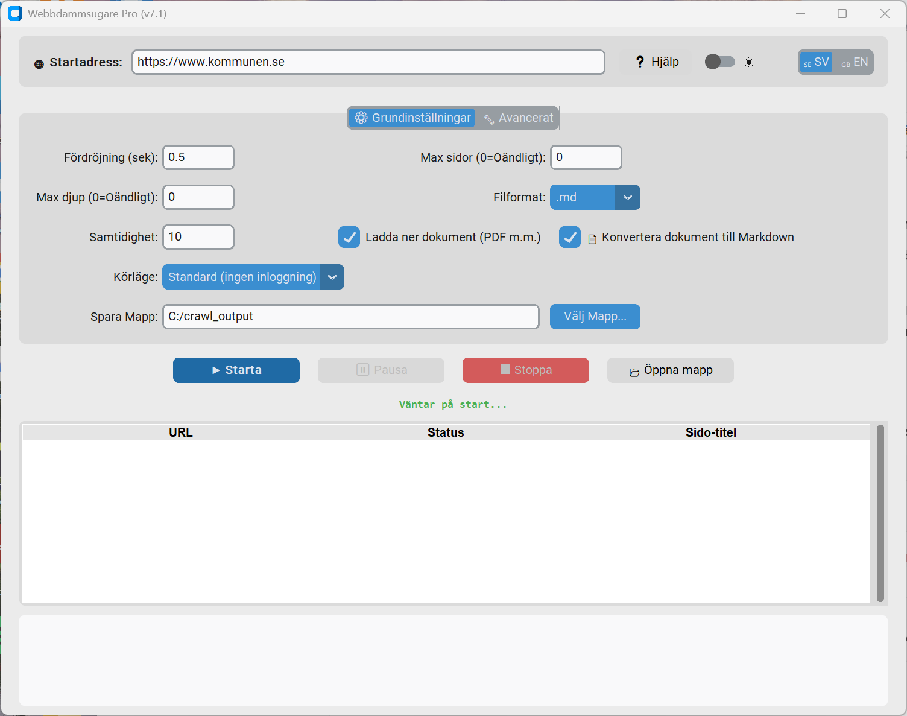

# 🕸️ Web Crawler Pro v7.1

[Svenska](README.md) | **English**



**Web Crawler Pro** (Swedish name: *Webbdammsugare Pro*) is a tool for scraping, structuring and storing website content, designed to produce high-quality text for AI models, retrieval-augmented generation (RAG) pipelines and vector databases. The GUI supports both Swedish and English.

---

## 🚀 Main features

### Crawling and networking

- **Asynchronous architecture:** Built on `asyncio` and `aiohttp`, with configurable concurrency (10 parallel pages by default) and separate Playwright semaphores (maximum 2).
- **Incremental crawling with conditional GET:** Stores `ETag`, `Last-Modified` and each page's outgoing links per URL. On a 304 response, cached links are replayed so child pages are still visited. Previously known pages and documents are also queued last when `incremental=true` and `max_depth=0`, even if their links have disappeared. Current URL filters and `max_pages` still apply. HTTP 404/410 removes the files and cache entry; for documents, this also removes the converted text. A full recrawl also cleans up visited 404/410 pages.
- **Change log and report:** Each run writes `changes.jsonl` (new, updated and removed pages/documents) and `crawl_report.json` (gaps, errors and warnings), supporting incremental updates of a RAG knowledge base.
- **Hybrid engine:** Fetches pages efficiently with aiohttp and falls back to Playwright when JavaScript rendering is needed.
- **CookieJar support:** Cookies obtained through Playwright login are injected into aiohttp with the correct domain, path and secure flags, supporting SAML/SSO.
- **Per-domain rate limiting:** Respects each host's `robots.txt` and `Crawl-Delay`, including sitemap requests and redirects. Automatically slows the affected host after 429/503 responses and gradually returns to the configured rate after successful responses, while preserving the `Crawl-Delay` floor.
- **Retries:** HTTP document downloads make up to two retries after 429, 500, 502, 503, 504 and temporary connection or stream failures. Each attempt follows the host's rate limit. Document downloads accept `Retry-After` in seconds or as an HTTP date. If the server requests more than 60 seconds, the document download ends for that run. Exhausted retries report a download failure and retain the previous document version.
- **Crawl trap protection:** Skips excessively deep paths, repeated path segments and URLs with too many query parameters. `max_pages` counts completed and in-flight pages, including when a large sitemap fills the queue.
- **Canonical URLs and duplicates:** Keeps the source page until the canonical target has been checked and a usable file exists in the same run. Unavailable, rejected and unchecked targets appear under `canonical_unresolved`. Duplicate decisions happen after page checks, preferring an existing published copy so that a changed or removed original does not hide a surviving copy.
- **Processing cache:** Changes to PII redaction, extraction, quarantine policy or output format require fresh fetching/processing, even with an ETag or old sitemap lastmod. Language and URL filters are checked separately during export and do not invalidate unchanged text. Changed titles and metadata are written even when the body is unchanged. Hashing preserves word boundaries. Older cache entries without a processing profile are checked again.
- **Sitemap `lastmod`:** Unchanged pages may be skipped while their links are replayed. The safety interval starts at the last real HTTP check (`checked_at`, 200 or 304), independently of the last body fetch (`fetched_at`) and last observation (`crawled_at`). Sitemap skips do not move the check time. After `sitemap_lastmod_max_age_days` (default 14), a new conditional GET is made. Older entries without a check time are rechecked. Rendered JavaScript pages are never skipped using sitemap lastmod, because their data can change without changes to the HTML shell.
- **Language filtering:** `languages` (for example `["sv"]`, or the GUI language filter) skips pages whose `<html lang>` specifies another language and does not follow their links.
- **Bot protection and soft 404s:** Cloudflare challenges and HTTP 200 pages saying that the page was not found are not saved as knowledge content.
- **Sitemap loading:** Decompresses gzip and parses XML off the event loop. Sitemap indexes are followed breadth-first with up to four concurrent fetch and parse jobs and up to 500 unique sitemaps per run. Requests to the same host follow its rate limit. XML with DTDs or entity declarations is rejected.
- **Login detection:** Checks 401/403 responses or login pages against `session_check_url` (or the start page) before an expired session can stop the crawl. Configure an accessible protected resource if the start page is public. Permission denials appear under `access_denied`; unsuccessful session checks under `session_unverified`. Network errors prove neither a valid nor an expired session. Browser mode preserves HTTP status so 403/404/5xx pages do not become knowledge sources.
- **Priority URL queue:** Gives sitemap URLs higher priority, boosts words such as "policy" and "guide", and deprioritizes archives and news.
- **Batched database commits:** Commits every 25 changes or every 5 seconds, avoiding an fsync for every page.

### Content extraction

- **Trafilatura integration:** Text extraction for AI use, supporting Markdown, tables and links.
- **Semantic chunking:** Structured blocks of roughly 400 words with 50-word overlap, a heading, **heading path**, `context` (title plus heading path, with repetitions removed), content, chunk index and source URL. Tables keep their header when split across chunks; lists retain line breaks. PDF documents include `page_number` and a `page_url` deep link ending in `#page=X`.
- **Small sections:** Adjacent sibling sections are merged toward a minimum of 80 words, within the 400-word maximum. Headings remain in the text, and original paths are stored in `heading_paths`. Different parents, PDF pages, PowerPoint slides and Excel sheets stay separate. An isolated short section can still produce a small chunk.
- **HTML and Excel tables:** The BeautifulSoup fallback and Excel conversion pad short rows with empty cells so every row has the same number of columns. Pipes in cell values are written as `\|` and explicit line breaks as `<br>`. When a table spans several chunks, the header is carried forward. The page and document processing profiles have been versioned so that stored text is rebuilt when the sources are revisited.
- **CMS boilerplate removal:** Removes Sitevision interface content such as feedback widgets and publication footers from all output formats.
- **Visible metadata:** Markdown files include last-modified, retrieval-date and language information in the body, allowing questions about source freshness to be answered.
- **Clean page titles:** Removes a trailing site name: "Avgifter - Tyresö kommun" becomes "Avgifter".
- **Absolute Markdown links:** Resolves relative links and canonical URLs against the final URL after redirects and the first `<base href>`. Preserves the actual request URL separately from its deduplication key, including trailing slash and query. Current links can replace older queued cache addresses that have not yet been fetched.
- **Source URL in every chunk:** Includes the source URL for reliable RAG citations.
- **URL normalization:** Removes known tracking parameters and Sitevision parameters such as `sv.*` and `logout`. It keeps `ref`, `source` and `state` by default because they can select content.

### Document handling

- **Document downloads:** PDF, Word, Excel, PowerPoint, ZIP and other formats.
- **Documents to Markdown:** Extracts text from binary documents and saves `.md` files with source URLs in the body, supporting citations to the original source.
- **Document context:** Repeats the title and source on each PDF page/PowerPoint slide and when splitting long sections (roughly 400 words), so external chunkers also retain source information. PDF headings include the title and page number, for example `Taxa 2025 – sida 12`. JSONL retains `page_number`/`page_url`; PowerPoint chunks have `slide_number`.
- **Document dates:** `Hämtad` records when the stored original version was retrieved. `Dokumentets ändringsdatum`, `Skapad` and `Serverns ändringsdatum` describe file metadata and HTTP `Last-Modified`. Corresponding JSONL fields are `fetched_at`, `document_modified_at`, `created_at` and `server_modified_at`. Time zones are preserved when present. These technical dates are **not effective dates**; dates are not inferred from filenames. Unknown older retrieval dates remain empty, including after a 304. Changes to link descriptions or server dates update the text without downloading the original again.
- **PDF structure:** Uses font size/boldness cautiously for headings, reads clear two-column text bands column by column and preserves detected tables as Markdown. Repeated short margin lines are removed only when present on at least three pages and at least 60 percent of pages; repeated body text is retained. Table detection uses existing [PyMuPDF functionality](https://pymupdf.readthedocs.io/en/latest/page.html#Page.find_tables), with raw text retained on failure. Complex layouts still need review against reference documents.
- **PowerPoint:** Includes text in nested groups, tables and speaker notes, preserving slide numbers and table columns. Notes come from the [slide's notes_text_frame](https://python-pptx.readthedocs.io/en/latest/user/notes.html), excluding note-master headers and slide numbers. Word tables also preserve pipe characters and line breaks within cells.
- **Document titles:** Prioritizes link text, document metadata, filename and referring page title, in that order. Filters generic labels such as "Download", "Click here" and their Swedish equivalents.
- **Document manifest:** Links each downloaded document to the page that referenced it, allowing the RAG system to look up the correct intranet citation URL.
- **File type detection and changes:** Checks the download signature and the package structure for ZIP-based formats. Content-Type, Content-Disposition and the URL provide hints. A verified type change at the same URL keeps the filename stem, updates the extension and replaces the original and its cache record in the next generation. A `document_updated` event also includes `previous_file` if the name changes. An invalid download retains the previous document version. Legacy Word, Excel and PowerPoint formats share a signature and also need a type hint. Content without a unique signature retains the previous extension. The ZIP directory can be up to 4 MiB during type detection.
- **Safe downloads:** HTTP and browser fallback stream to `.part` files using the `max_download_mb` limit (default 100). Type detection takes place before atomic replacement.
- **Document updates:** Uses conditional GET when validators are available. Otherwise, downloads the content and compares SHA-256 hashes. Equal file size never proves unchanged content.
- **Version-linked document text:** Exports text only after successful conversion has been registered for the original's SHA-256 and current conversion/PII settings. Removes old text before switching original versions in the working directory. A later run retries failed conversion even after a 304. If a registered original has been changed locally, a fresh GET is made without old validators.
- **Isolated document processes:** PDF/Office/OCR runs in a bounded queue with separate processes, private temporary files and timeouts. Each job returns its own OCR/error diagnostics. Downloads continue during conversion; backpressure starts when the queue is full. Parser crashes do not damage the crawler process or later jobs. Windows uses [Job Objects](https://learn.microsoft.com/en-us/windows/win32/procthread/job-objects); other platforms use a separate process group so descendants also terminate on timeout/cancellation. LibreOffice receives its own profile and cannot attach the job to the user's open LibreOffice session.
- **Registered-file export:** Builds `chunks.jsonl` from registered pages with the current processing profile and version-checked document text, including `.txt`. Older unregistered or outdated processed text is moved to `texter_utgangna/` and listed under `retired_text_files`. Old page text is removed when a page is rejected, becomes too short, requires login or becomes a binary document/image. Disallowed redirects are fetch failures and retain previous text. Limited runs retain unvisited registered pages when processing settings are unchanged. After a PII/processing policy change, old text must be reprocessed before export. Publication safeguards described below prevent unconfirmed mass loss from replacing the active corpus.
- **Older-document migration:** Older text lacks a version link and must be reconverted when the original is checked again. Run an incremental crawl without page/depth limits after upgrading to refill the corpus. Unregistered older text remains in `texter_utgangna/` for review and must not be imported into the knowledge base.
- **Legacy formats:** Converts `.doc`, `.xls`, `.ppt`, `.odt`, `.rtf` and related formats through an installed LibreOffice when `allow_libreoffice=true`. By default, originals are saved and new conversions are listed under `legacy_conversion_skipped`. Cached text remains reusable while its version and processing profile match. Word tables stay in document order and hidden Excel sheets are skipped.
- **PDF OCR:** Tesseract through PyMuPDF reads pages without a text layer, can supplement large image regions, and can repair individual lines in a faulty older OCR layer. Documents containing OCR text are marked `**Textkälla:** OCR`.

### Other features

- **PII redaction for GDPR workflows:** Masks email addresses, phone numbers, Swedish personal identity numbers and IP addresses. Phone patterns handle `tel:` links, labels such as `Tfn:` and `Mobil:`, and parentheses while preserving case/reference numbers (for example `2024-0312-0012` and `KS/2024:0312-0012`), Swedish statute numbers and organization numbers. Redaction also covers link text, titles and document titles. Email, phone and personal-identity redaction are enabled by default in the GUI. `keep_role_emails=true` preserves role mailboxes such as `kontakt@` and `registrator@`. **Names are not masked; redaction does not replace a GDPR assessment.**
- **Prompt-injection detection and quarantine:** Checks page text, titles, exported metadata, links, heading paths, comments and detected hidden elements. Matching accounts for Unicode variants, invisible formatting characters and variable whitespace. Matching hidden elements are removed before extraction, including elements with common CSS classes and content in `template` elements. Normal FAQ panels, tabs and accessibility text are retained. Flagged text goes to `texter_karantan/` and its chunks to `chunks_quarantine.jsonl` when `quarantine_flagged_chunks` is enabled (default `true`).
- **Document checks:** Applies the same injection patterns to extracted document text and saved metadata. Flagged text follows the same quarantine policy and the original file is retained. Newlines in titles and metadata cannot inject fake source fields into Markdown or plain text.
- **Templates in `sites.json`:** GUI dropdown with preset settings.
- **Swedish/English GUI:** Switch interface language while the program is running.
- **Light/dark theme:** Toggle ☀️ / 🌙 without restarting.
- **Server mode (CLI):** Headless operation with JSON configuration and optional webhook notifications.

---

## ✅ Requirements

| Requirement | Details |
|---|---|
| **Python** | **3.11+** |
| **Chromium** | Installed using `playwright install chromium` (see below) |

> **Note:** Playwright downloads and manages its own Chromium instance. You do not need to install Google Chrome separately.

---

## 🛠️ Installation

**1. Clone the repository:**

```bash
git clone https://github.com/elementarpartikel/ultimate-web-crawler.git
cd ultimate-web-crawler
```

**2. Install dependencies:**

```bash
pip install -r requirements.txt
```

| Package | Purpose |
|---|---|
| `aiohttp` + `aiosqlite` | Asynchronous HTTP requests and database access |
| `beautifulsoup4` + `lxml` | HTML and XML parsing |
| `playwright` | JavaScript rendering with Chromium |
| `trafilatura` | Text extraction for AI use |
| `customtkinter` (6.x) | GUI with light/dark themes |

> The GUI is tested on Windows 11 with Python 3.14, CustomTkinter 6.0 and Tk 9.0. The Tk version comes with the Python installation. The interface uses Segoe UI and follows display scaling, including when the window moves between displays.

**3. Install Playwright's browser** — required:

```bash
playwright install chromium
```

> Downloads Playwright's Chromium (approximately 150 MB). This only needs to be done once.

**4. Install optional document-conversion dependencies:**

```bash
pip install PyMuPDF python-docx openpyxl python-pptx
```

| Package | Purpose |
|---|---|
| `PyMuPDF` | PDF text extraction |
| `python-docx` | Word text extraction (.docx/.dotx) |
| `openpyxl` | Excel text extraction (.xlsx) |
| `python-pptx` | PowerPoint text extraction (.pptx) |

**5. Other optional dependencies:**

```bash
pip install uvloop brotli
```

| Package | Purpose |
|---|---|
| `uvloop` | Faster event loop (Linux/macOS only) |
| `brotli` | Brotli-compressed HTTP responses |

---

## 🖥️ Usage

### Desktop app

```bash
python ultimate-web-crawler.py
```

**Accessibility.** The desktop app is not adapted for screen readers. The Tk interface does not expose names or roles to Windows assistive technology. Server mode can run in a terminal with a screen reader. The desktop app follows display scaling and supports keyboard use.

| Key | Action |
|---|---|
| Tab / Shift+Tab | Moves between all visible controls in reading order. A focus ring shows where you are. |
| Space / Enter | Activates buttons and checkboxes and turns dark mode on or off. |
| Left/Right arrow | Switches tabs and language. |
| Up/Down arrow | Steps through menu values. Alt+Down opens the menu. |
| Enter in the results list | Opens the selected page. |
| Ctrl+C in the results list | Copies the page address. |
| Ctrl+Plus / Ctrl+Minus / Ctrl+0 | Increases, decreases or resets the text size. |
| Menu key / Shift+F10 | Opens the context menu in the results list and the log, which right-click also opens. |
| Ctrl+A in the log | Selects the whole log. |
| Esc | Closes tooltips and Help. |

**Text size:** Choose **Text 100%** to **Text 200%** in the top row. When the window becomes too narrow for the normal layout, the settings are shown in a single column. If the content still does not fit, scroll bars appear and the focused control is scrolled into view.

**The log** follows new lines as long as the latest line is visible. Scroll up to read an older line and the log stays there.

**Invalid values:** If a field has an invalid value when you choose **Start**, the message names the field and the allowed values. The cursor then moves to that field. Delay accepts a decimal comma or a decimal point.

The text size is remembered for next time. Enlarging text scrolls the focused control into view. In a small window, you can scroll the entire interface to reach the results and log. Drag the divider between results and log to change the split. The log is read-only, but its lines can be selected and copied. The goals and the decision are documented in [DESIGNPLAN-WCAG.md](DESIGNPLAN-WCAG.md) (Swedish).

### Templates

Place `sites.json` in the same directory as `ultimate-web-crawler.py` (or the packaged executable). A **📋 Template** dropdown appears automatically in the GUI. Select a template and click Start; settings are filled in and advanced keys are preserved. The output directory comes from `output_dir` when specified, or becomes a subdirectory based on the template name (for example `crawl_output/skolverket`).

The same `sites.json` works in server mode with `--config`; see Server mode below.

### GUI settings

`Visited` includes both `Pages` and `Cached`. The GUI shows outstanding document conversions separately. If you close the window during a run, you can choose to stop it and close the window once the report is ready.

The final status shows **Successful run** in green, **Partial run** in amber or **Failed run** in red. The summary's counters and warnings follow the selected language. **Open report** becomes available once the report has been written and opens it in the system's default app. It usually opens `crawl_report.json` in the run's output directory. For an early error reported separately, it opens the file in `reports/`. Technical error messages appear in the report and log.

**Basic settings:**

| Setting | Description |
|---|---|
| **Start URL** | Full URL, including `https://` |
| **Delay** | Seconds between requests per domain (default 0.5) |
| **Max pages** | `0` crawls the entire site |
| **Max depth** | Link depth from the start page (`0` is unlimited) |
| **Concurrency** | Parallel pages (default 10) |
| **File format** | See Output formats below |
| **Download documents** | Saves PDF, DOCX and other files under `dokument/` |
| **Convert documents to Markdown** | Extracts text into `.md` files with source URLs |
| **Run mode** | See Run modes below |
| **Full recrawl** (Advanced) | Ignores the cache and fetches everything again |
| **Folder** | Directory for saved output |

**Output formats:**

| Format | Description |
|---|---|
| **.json** | Structured data with headings, chunks and metadata; recommended for vector databases |
| **.md** | Markdown with source URLs in the body; suitable for RAG and LLM use. Default format |
| **.txt** | Plain text |
| **No text** | Crawls and downloads documents without saving page text |

**Run modes:**

| Swedish label | English label | Description |
|---|---|---|
| Standard (ingen inloggning) | **Standard (no login)** | Runs in the background without a visible browser, for sites that do not require login |
| Logga in först, sen automatiskt | **Log in first, then automatic** | Opens a visible browser for manual login, then continues in the background |
| Synlig webbläsare (felsökning) | **Visible browser (debugging)** | Shows the browser window to help inspect what happens |

**Advanced settings:**

| Setting | Description |
|---|---|
| **Hybrid engine** | Chooses aiohttp or Playwright per page |
| **Trafilatura** | Enables text extraction for AI use |
| **Sitemap.xml** | Loads sitemaps recursively, including gzip-compressed files |
| **robots.txt** | Respects crawling rules and Crawl-Delay |
| **Strict domain** | Restricts crawling to the configured domain |
| **Exclude words in URL** | Comma-separated list; matching URLs are skipped |
| **Require words in URL (any of)** | Visits only URLs containing at least one listed word (OR logic) |

**PII redaction (GDPR):**

| Setting | What is masked |
|---|---|
| **Remove email** | `kontakt@myndighet.se` → `[E-POST]` |
| **Remove phone numbers** | Swedish formats, including country code and parentheses → `[TELEFON]` |
| **Remove Swedish SSN** | Personal identity and coordination numbers → `[PERSONNUMMER]` |
| **Remove IP addresses** | IPv4 addresses → `[IP-ADRESS]` |

Personal identity numbers without an explicit label are checked for a valid date and Luhn checksum; coordination numbers are also supported. Explicit phone context (`tel:`, `Telefon:`, `Mobil:`, etc.) is preserved when `remove_phone=false`. A digit sequence can be both a valid identity number and a phone number: without context, identity-number masking takes precedence. IPv4 redaction validates octets and preserves explicitly labelled section/version numbers, such as `Section 1.2.3.4`. Redaction is heuristic and does not guarantee detection of all personal data.

> 💡 Double-click any row in the *Live Data* table to open its URL in your browser.

---

## 💻 Server mode

Run headlessly with JSON configuration for scheduled operation using `cron` or Windows Task Scheduler:

```bash
python ultimate-web-crawler.py --config sites.json
python ultimate-web-crawler.py --config sites.json --webhook "https://hooks.slack.com/..."
```

> The webhook URL can also be set through `WEBHOOK_URL`. Up to three sites run in parallel. Each site gets its own subdirectory under `server_data/`. Override it with `--output DIR`, particularly in Task Scheduler where the working directory may differ.
>
> Server mode does **not** require tkinter/customtkinter and works on headless Linux. Exit code **0** means all sites succeeded; **1** means at least one site had a partial/failed run or invalid configuration; **2** means the configuration file could not be read. Page, document, conversion, robots.txt reachability and export errors therefore produce exit code 1. Unknown configuration keys produce a warning; a missing/invalid `start_url` skips that site.

When names collide, a folder receives an available numeric suffix.

### Server-mode login (`cookie_file`)

Interactive login requires the GUI. For scheduled intranet runs with login, set `headless_mode` to `login_then_headless` and `cookie_file` to a protected path such as `C:/secure/cookies.json`. Private network targets also require `allow_private_hosts=true`. First run a logged-in GUI crawl using the same `cookie_file` in its template; session cookies are saved there. Server mode reads them and verifies the session. Expired cookies stop the run with a clear error and exit code 1. **Treat the cookie file like a password.** After five consecutive confirmed session failures, the crawl stops rather than continuing without login.

Only cookies applicable to the start host or allowed document/page hosts are saved and transferred to aiohttp. Domain cookies may apply to a parent domain and retain their scope; host-only cookies are not broadened to subdomains. Other identity-provider cookies may remain in memory during the GUI run but are not saved to disk. Renew login through the GUI if the site's own cookies no longer suffice. SSO hosts can be used during interactive login; ordinary crawling does not follow disallowed navigation targets when `strict_domain=true`.

Cookie files are written atomically. On Windows they are created with a protected ACL for the file owner and SYSTEM; POSIX uses `0600` from creation. They remain unencrypted: protect storage and backups as well. A write failure leaves the previous file intact.

GUI templates preserve all known advanced settings; visible GUI choices can override the template. The selected template is restored from `sites.json` after restarting. Changing the start URL's origin (scheme, host or port) detaches advanced template settings so that cookies and domain exceptions do not carry over to another site. Paths may change within the same origin. A template's explicit `output_dir` is respected, and No text/Ingen text is saved independently of language.

### Advanced `sites.json` settings

| Key | Default | Description |
|---|---|---|
| `cookie_file` | – | Path for saving/loading session cookies |
| `user_agent` | `UltimateWebCrawler/7.1 (+repo-URL)` | Honest crawler identification; customize if needed |
| `allowed_domains` | `[]` | Additional domains considered part of the site with `strict_domain` |
| `include_subdomains` | `false` | Allows subdomains of the start domain |
| `max_page_mb` / `max_download_mb` | `10` / `100` | Page/document size limits in MiB. Automatic browser rendering limits both the page's combined decoded response bodies (HTML/JS/fetch, etc.) and its serialized DOM; documents are streamed separately using the document limit |
| `spa_wait_seconds` | `3` | Additional wait after `DOMContentLoaded`, 0–60 seconds. `0` disables the wait |
| `spa_ready_selector` | empty | Optional selector for a visible element indicating the page is ready. Enables rendering for the site's HTML pages in hybrid mode as well |
| `max_path_segments` / `max_query_params` | `15` / `5` | Crawl trap limits |
| `keep_query_params` / `ignore_query_params` | `[]` | Exempts exact parameter names from the default deduplication list or adds them to it, respectively. `ref`, `source` and `state` are kept by default |
| `boost_words` / `penalty_words` | see code | URL words that increase/decrease priority |
| `keep_role_emails` | `false` | Preserves role mailboxes such as `kontakt@` during email redaction |
| `ignore_https_errors` | `false` | Ignores browser certificate errors, for example with an intranet's own CA |
| `allow_private_hosts` | `false` in server mode, automatic in the GUI | `true` allows private network targets. Set it explicitly for scheduled intranet crawls. `false` requires public targets |
| `incremental` | `true` | `false` performs a full recrawl |
| `session_check_url` | start page | Accessible protected resource for verifying login; configure if the start page is public |
| `languages` | `[]` (all) | Only these languages, for example `["sv"]` |
| `respect_canonical` | `true` | Avoids saving copies of pages that identify another URL as the original |
| `dedupe_content` | `true` | Keeps one copy of pages with identical content |
| `use_sitemap_lastmod` | `true` | Skips pages reported unchanged by the sitemap |
| `sitemap_lastmod_max_age_days` | `14` | Rechecks older entries even when lastmod is unchanged |
| `export_jsonl` | `true` | Writes `chunks.jsonl`, one chunk per line |
| `quarantine_flagged_chunks` | `true` | Separates flagged chunks, such as possible prompt injection, into `chunks_quarantine.jsonl` instead of `chunks.jsonl` |
| `ocr` / `ocr_languages` / `ocr_max_pages` | `true` / `swe+eng` / `50` | Scanned-PDF OCR; requires Tesseract |
| `conversion_workers` | `2` | Concurrent document processes per site, independent of fetch `concurrency` |
| `conversion_queue_size` | `8` | Maximum waiting conversion jobs; running processes are counted separately |
| `conversion_timeout` | `180` | Seconds per worker, including startup/imports; increase for large scans. Timeout/cancellation also terminates descendants |
| `conversion_memory_mb` | `1024` | Memory limit in MiB per conversion job, minimum `64`. Windows limits both each process and total committed memory of the process tree using a Job Object. POSIX uses per-process `RLIMIT_AS`; children inherit it, but this is not a shared tree budget. Concurrent jobs have separate budgets |
| `allow_libreoffice` | `false` | Allow new LibreOffice conversions for trusted documents. Originals are downloaded with either setting |
| `generation_keep` | `0` | Optional history cleanup: `0` keeps all; `10` keeps the current generation and nine latest older generations, plus those within the grace period |
| `changes_history_max_entries` | `0` | Optional event limit for `changes.jsonl`. `0` retains the full history. All new events from the latest run are kept even when they exceed the limit |
| `generation_min_age_hours` | `24` | Grace period from when a generation is first recorded as inactive; must exceed the longest RAG import that pins a generation |

Keep `ultimate-web-crawler.py`, `crawler_runtime.py`, `conversion_worker.py`, `document_conversion.py`, `pdf_scan_tables.py`, `pdf_dense_currency.py`, `pdf_source_corrections.py` and `crawler_text.py` in the same directory when running source code. Worker startup also supports `pythonw` and an internal entry point for packaged programs. Advanced settings work in the CLI and are preserved when selecting a GUI template. PDF workers load only the PDF parser, without GUI, HTML/network libraries or Office parsers.

When rendering without a selector, the crawler observes the page for at least 0.75 seconds within the time budget. It continues once the main text has been stable for 0.25 seconds and pending fetch/XHR requests have finished. When the budget expires, the crawler uses the latest available page text. If text is missing or a configured selector is still invisible, the page is reported under `spa_timeouts` and the previous source text is retained. Configuring a selector also prevents reuse of an old HTML shell via sitemap lastmod or conditional GET.

Missing delay, page/depth limit and concurrency settings receive defaults of `0.5`, `0`, `0` and `10`/`2`. Numeric strings are normalized; negative values, NaN/infinity, invalid integers and incorrect list/boolean types are rejected before crawling. Both `exclude_keywords` and `require_keywords` match case-insensitively in GUI and CLI.

### Sources with content-selecting URL parameters

Different values of `ref`, `source` and `state` use separate cache entries and filenames for pages and documents by default. If a particular site uses a parameter only for tracking, add it to that site's `ignore_query_params` to keep the previous deduplication behavior.

During an upgrade, the crawler uses the request address stored in the page cache to move known variants to their own keys and filenames. The page's citation and existing chunk IDs carry over when the same content is reused. Filename changes are recorded with `previous_file` in `changes.jsonl`. The migration takes place in the next generation and also covers known pages that a limited run does not reach.

Older document cache entries lack the request address. The next check of the registered document address fetches it without the previous HTTP validators. A confirmed 404 or 410 removes the old entry. New document variants receive their own citations and chunk IDs when fetched. When importing, read the file registry and `chunks.jsonl` from the same new generation. The change log continues to redact query strings.

### Example `sites.json`

These examples cover RAG text extraction, document downloads with Markdown conversion, and intranet crawling with login. Swedish site names and URL-filter words are retained because the example websites are Swedish. `save_format` accepts both `"Ingen text"` and `"No text"` for document-only crawling.

```json
[
  {
    "name": "Skolverket (RAG & AI-text)",
    "start_url": "https://www.skolverket.se",
    "delay": 0.5,
    "max_pages": 500,
    "max_depth": 3,
    "concurrency": 10,
    "save_format": ".md",
    "headless_mode": "headless",
    "find_sitemap": true,
    "respect_robots": true,
    "use_hybrid": true,
    "use_trafilatura": true,
    "download_docs": false,
    "convert_docs_to_md": false,
    "strict_domain": true,
    "exclude_keywords": ["images", "login", "kalender"],
    "require_keywords": [],
    "remove_email": true,
    "remove_phone": true,
    "remove_pnr": true,
    "remove_ip": false
  },
  {
    "name": "SKR (Dokument + Markdown)",
    "start_url": "https://skr.se",
    "delay": 0.5,
    "max_pages": 500,
    "max_depth": 1,
    "concurrency": 10,
    "save_format": "Ingen text",
    "headless_mode": "headless",
    "find_sitemap": true,
    "respect_robots": true,
    "use_hybrid": true,
    "use_trafilatura": false,
    "download_docs": true,
    "convert_docs_to_md": true,
    "strict_domain": true,
    "exclude_keywords": [],
    "require_keywords": [],
    "remove_email": false,
    "remove_phone": false,
    "remove_pnr": false,
    "remove_ip": false
  },
  {
    "name": "Kommun-intranät (inloggning)",
    "start_url": "https://intranat.kommun.se",
    "delay": 1.0,
    "max_pages": 0,
    "max_depth": 0,
    "concurrency": 5,
    "save_format": ".md",
    "headless_mode": "login_then_headless",
    "find_sitemap": true,
    "respect_robots": false,
    "use_hybrid": true,
    "use_trafilatura": true,
    "download_docs": true,
    "convert_docs_to_md": true,
    "strict_domain": true,
    "exclude_keywords": ["logout", "kalender", "arkiv"],
    "require_keywords": [],
    "remove_email": true,
    "remove_phone": true,
    "remove_pnr": true,
    "remove_ip": true
  }
]
```

---

## 📂 Output structure

Folder names remain the same in both interface languages. Placeholder filenames below illustrate generated page/document names.

```text
crawl_output/
├── current.json                     # Atomic entry point to the published generation
├── .generations/<id>/               # Complete generation: text, originals, index, manifest, chunks and report
├── .working/<id>/                   # In-progress run; never an import source
├── texter/                          # One file per approved page
│   ├── page_name_a1b2c3d4.md        # Or .json / .txt
│   └── document_name_a1b2c3d4_doc.md # Converted documents
├── texter_karantan/                 # Quarantined text, e.g. possible prompt injection
├── dokument/                        # Downloaded PDF, DOCX, XLSX and other files
├── logs/
│   └── crawl_YYYYMMDD_HHMMSS.log
├── index.csv                        # URL, title, date and filename; existing files only
├── chunks.jsonl                     # Clean chunks, ready for vector-database import
├── chunks_quarantine.jsonl          # Separate chunks from flagged sources
├── changes.jsonl                    # New/updated/removed resources; appended each run
├── crawl_report.json                # Gaps, errors, warnings and sources not seen since the previous run
├── manifest_domainname.json         # Links documents to their referring pages
└── domainname_cache.db              # SQLite cache for incremental crawling
```

### Consistent imports through `current.json`

The crawler prepares a complete delivery in a working directory and replaces `current.json` only after conversions, index, manifest, corpus and report are ready. A `failed` run, export error or cancellation before commit leaves the previous generation and its cache intact. A completed run with isolated fetch/conversion errors can publish a clean `partial` generation with error details in the report; CLI exit code remains 1. A commit that has already started is completed even if its wait is cancelled.

Unreachable robots.txt stops new fetches on the affected origin but does not remove saved content. Robots fetching retries up to twice. Public 401/403 responses are fetch failures and retain previous sources. If more than half the previous generation's clean source files disappear without evidence, publication stops and `publication_blocked` explains the loss. Real HTTP 404/410 responses, explicit selection/processing changes, quarantine and confirmed duplicate decisions can explain removals. A soft 404 or short HTTP 200 page does not justify mass deletion. A site confirmed to be empty can therefore publish an empty corpus.

Processing profiles cover PII redaction, format, quarantine policy and extractor. URL/language selection and fetch engine are outside the profile; selection is checked separately at export, including unvisited sources. When upgrading from older page/document profiles without a profile description, a limited first run may be stopped by the loss safeguard. Run once with `max_pages=0` and `max_depth=0` so sources can be reprocessed. The previous delivery remains available meanwhile.

When importing into a RAG service, **read `current.json` once and use the same generation directory for the entire import**:

```python
from pathlib import Path
import json

root = Path("crawl_output")
pointer = json.loads((root / "current.json").read_text(encoding="utf-8"))
generation = root / pointer["generation"]
if pointer["corpus"] is not None:
    corpus_path = generation / pointer["corpus"]
    # Read chunks.jsonl, index.csv and manifests from this generation directory.
```

`generation.json` describes that delivery. `artifacts` lists delivery files, excluding the cache and retired-text archives. `corpus` points to clean chunks; `quarantine` is separate and must not enter the regular corpus. With `export_jsonl=false`, `corpus` is empty and old JSONL files are removed from the new delivery.

Legacy top-level paths (`texter/`, `chunks.jsonl`, `index.csv` and manifests) remain as compatibility copies. They are **not** replaced together atomically; integrations must use the generation directory for the consistency guarantee. Copies do not share hard links with the generation and cannot modify it. A failed compatibility-copy update produces an error status while the complete published generation remains available.

The top-level `crawl_report.json` describes the latest attempt, with `publication_committed` and `published_generation`. The report inside a generation belongs to that delivery. The next run restores its cache from the published generation. The output directory is locked against concurrent writers; abandoned working directories are cleaned on restart. Previous generations are retained by default for pinned readers. Scheduled deployments can enable cleanup with, for example, `generation_keep=10` and `generation_min_age_hours=24`; set a grace period longer than the readers' maximum import time. The current generation and N latest generations stay protected; the grace period may temporarily retain more than N directories. Cleanup appears in `generation_cleanup`; `generation_cleanup_failures` reports cleanup errors separately without rolling back a complete delivery. This cleanup does not cover text archives or logs. Retired text archives must not enter RAG imports.

`crawl_report.json.status` is `success` when no run errors occurred, `partial` when at least one resource was fetched/checked but others failed or the run stopped, and `failed` for fatal errors or a run with errors in which nothing succeeded. Export errors are always fatal. Intentional limits such as `max_pages`, normal removals and robots exclusions are not run errors. `completed_naturally` independently indicates whether the queue was emptied. The report is also written when login fails before crawling begins.

Robots rules are loaded separately per scheme, host and port and checked before the start page and every redirect. A robots.txt 4xx response permits fetching; 5xx/network failure stops fetching on the affected origin and appears under `robots_unreachable`, following [RFC 9309](https://www.rfc-editor.org/rfc/rfc9309.html#section-2.3.1). `robots_denied` lists blocked URLs. Sitemap discovery also works with `respect_robots=false`.

Document browser fallback is used only in `login_then_headless` after a 401/403 or HTML response. Chromium streams attachments and inline documents under `max_download_mb`; oversized transfers are aborted and temporary files removed. Native browser downloads are disabled so they cannot bypass the limit.

### JSON output per page

These output examples retain Swedish source text and fixed metadata labels used by the crawler. The GUI language does not translate website content or change output field names.

```json
{
  "title": "Kontakta oss - Skolverket",
  "url": "https://www.skolverket.se/kontakt",
  "crawled_at": "2026-04-03T12:00:00",
  "author": "",
  "published_date": "",
  "modified_date": "2026-03-15",
  "language": "sv",
  "og_type": "",
  "description": "Så når du Skolverket",
  "keywords": ["kontakt"],
  "flags": [],
  "plain_text": "## Ring oss\nNi når oss på [TELEFON]...",
  "chunks": [
    {
      "heading": "Ring oss",
      "heading_path": "Ring oss",
      "context": "Kontakta oss > Ring oss",
      "content": "Ni når oss på [TELEFON]. Vår e-post är [E-POST].",
      "chunk_index": 1,
      "total_chunks": 3,
      "url": "https://www.skolverket.se/kontakt"
    }
  ]
}
```

### Markdown output per page

Metadata labels include `Källa` (source), `Senast ändrad` (last modified), `Hämtad` (retrieved) and `Språk` (language).

```markdown
# Kontakta oss - Skolverket

**Källa:** https://www.skolverket.se/kontakt
**Senast ändrad:** 2026-03-15
**Hämtad:** 2026-04-03
**Språk:** sv

---

## Ring oss
Ni når oss på [TELEFON]. Vår e-post är [E-POST].

---

**Källa:** https://www.skolverket.se/kontakt
```

### Converted document (Markdown)

`Dokument-URL` is the document URL, `Filnamn` the filename and `Filtyp` the file type. The abbreviated example below shows the source blocks; full output also includes available dates and repeated context within the document.

```markdown
# Budget 2025

**Källa:** https://intranat.kommun.se/ekonomi
**Dokument-URL:** https://intranat.kommun.se/download/budget-2025.pdf
**Filnamn:** budget-2025.pdf
**Filtyp:** PDF

---

## Sida 1

[dokumenttext...]

---

**Källa:** https://intranat.kommun.se/ekonomi
**Dokument-URL:** https://intranat.kommun.se/download/budget-2025.pdf
```

---

## 📦 chunks.jsonl — importing into vector databases or RAG services

After each run, `chunks.jsonl` is built from all approved pages and documents, including unchanged ones, to provide the complete approved corpus for import. Source text files and chunks with possible prompt injection or other security flags are separated into `texter_karantan/` and `chunks_quarantine.jsonl`. Each line is a record:

```json
{"id": "a1b2c3d4e5-1", "url": "https://…/avgifter", "title": "Avgifter", "source_type": "page",
 "referer_url": "", "language": "sv", "modified_date": "2026-03-15", "crawled_at": "2026-04-03",
 "heading": "Förskola", "heading_path": "Avgifter > Förskola", "context": "Avgifter > Förskola",
 "content": "…", "chunk_index": 1, "total_chunks": 4, "flags": []}
```

For documents, `source_type` is `document`, `url` is the document address and `referer_url` is the referring page. PDF chunks include `page_number` (for example 14) and `page_url`, such as `https://…/policy.pdf#page=14`; PowerPoint chunks include `slide_number`. Merged sections include the original `heading_paths`. An ID combines the source hash and chunk sequence number: the source portion is stable, but changes to chunking can move content between IDs. Replace all chunks for an updated source and remove old IDs using `changes.jsonl` and the file registry.

The PDF's Markdown export includes the physical page number and a clickable page link in a separate body paragraph. The paragraph is repeated when a PDF page is split into multiple sections. This makes the page information available when a RAG service reads the body text and drops the heading. In `chunks.jsonl` the information is stored in `page_number` and `page_url`. Unchanged PDF originals can be reconverted from the cache on their next check after upgrading.

Tables extracted from web pages and converted documents are followed by one plain paragraph per data row in the source files and in `chunks.jsonl`. Each populated cell is labelled with its column heading, as in `Tabellrad. Biljettyp: Morgonsim senior. Pris i kronor: 85.`. A column with no heading is labelled by position, such as `Kolumn 2`. The original table is also retained. The paragraphs keep the relationship between values even when a RAG service drops table cells during import. After upgrading, web pages need to be fetched again. Unchanged documents can be reconverted from the saved originals.

Chunk export reuses rows for unchanged, registered source files from the previous generation. When the entire selection is unchanged, generations can share the same JSONL file via hard links. When a source changes, the crawler writes a new complete JSONL file. If the export index is missing or invalid, the crawler rebuilds from the source files. The `chunk_export` report gives the source file count, the number reused, whether the whole JSONL export was reused and the combined size of the clean and quarantine exports in bytes.

When `changes_history_max_entries` is positive, the crawler keeps the most recent historical events that fit after adding the new events. An older run can therefore be retained in part. If the last imported run is missing or only partly retained, resynchronize from the pinned generation's complete corpus and file registry. The `changes_history` report gives the limit, file size and whether history was trimmed during the run. Previous generations retain their logs under the separate generation cleanup policy.

---

## Acceptance test for the main workflow

Run `python -m pytest tests/test_rag_acceptance.py -q` to exercise the workflow locally. The crawler starts from one URL, follows links to 100 ordinary HTML pages and converts a digital PDF, a Word document and an Excel worksheet. The test reads `chunks.jsonl` from the generation selected by `current.json`. Four queries in a local SQLite FTS5 index check facts and citations, including a deep link to the correct PDF page.

On the second run, one page changes and produces fewer chunks. The test checks that the other 99 pages return HTTP 304, that the documents are reused and that obsolete search results disappear when the page's chunks are replaced.

In a local generation test on 6 November 2026, the crawler first published 103 Markdown files. On the second run, the group room closing time changed from 19:00 to 22:15, while the page about lost school keys returned HTTP 404. The crawler published 102 files, reused 101 sources and recorded one update and one removal in `changes.jsonl`. The study workshop file was identical in both generations. The first generation could still be read with its original fact and the removed file.

---

## 🔍 OCR for scanned PDFs

Many municipal PDFs are scans without a text layer. To read them:

1. Install **Tesseract** (on Windows, use the UB Mannheim installer), select the required language data, including Swedish for `swe+eng`, and add it to `PATH`.
2. The crawler applies OCR to pages without a text layer and can supplement pages whose larger image regions lack sufficient text. These paths and dense table rereads share `ocr_max_pages` (default 50). Failed attempts also count.

If Tesseract is unavailable, scanned documents appear under `conversion_failures` in `crawl_report.json` with a reason. OCR text can contain errors and is labelled accordingly.

---

## 🔒 Security and data protection

- **Access control:** When crawling an intranet with a user's login, everything that account can access may enter the output and become accessible to everyone who uses the RAG service. Use a dedicated account with minimal permissions and review what is imported.
- **Network protection:** aiohttp checks IP literals and DNS results, including redirects. In public mode, Chromium's local SOCKS5 proxy checks every TCP target and connects to the validated IP. This covers rendering, redirects, popups, interactive login and browser downloads. Implicit loopback bypass, QUIC and WebRTC traffic outside the proxy are disabled. Service Workers are blocked and browser documents stream through CDP with a size limit. Proxy failure stops the connection.
- **Public IP targets:** Literals, DNS answers and proxy connections use the same address check. It blocks NAT64 prefixes `64:ff9b::/96` and `64:ff9b:1::/48`, 6to4 and Teredo. IPv4-mapped addresses are checked as IPv4. Networks with their own translation prefix need to account for it in their network policy. [RFC 6052](https://www.rfc-editor.org/rfc/rfc6052.html) · [RFC 8215](https://www.rfc-editor.org/rfc/rfc8215.html)
- **Intranet mode:** Server mode requires `allow_private_hosts=true` to reach private addresses. In the GUI, `localhost`, loopback, RFC 1918 private IPv4 addresses and IPv6 ULA can enable the mode automatically. For a DNS name, all resolved addresses must fall into these groups. Set `allow_private_hosts=false` to enforce public policy in the GUI too. Permission is logged as a warning and `crawl_report.json` records the decision under `network_policy`.
- **Limits:** Bounds page/download sizes and decompressed sitemaps. XML containing entities is rejected.
- **HTTPS:** Browser certificate errors are ignored only with explicit `ignore_https_errors` configuration.
- **Cookie files:** `cookie_file` is equivalent to a password. Its contents are never logged; keep it in a protected directory.
- **Diagnostic URLs** retain the path and omit the entire query string, fragment and user information from HTTP(S) addresses in crawler logs, `crawl_report.json` and `changes.jsonl`. This also applies to error messages. Use `file` in the change log to distinguish sources that differ only in their query string. Fetching, the cache, the file registry and the source references in the text can still contain full addresses. The next published generation redacts older change records even when the run has no new changes. Previous generations and log files can still contain older addresses.
- **Untrusted LLM input:** Detection is heuristic and may miss instructions or flag legitimate text. Matching sources are reported under `possible_prompt_injection` in `crawl_report.json` and exported to quarantine when it is enabled. A RAG service should treat unflagged sources as untrusted input as well.
- **Document parsing:** PDF/Office/OCR runs in separate processes with time limits and private input copies. Workers and LibreOffice receive an allowlist of system, language and path variables, including `TESSDATA_PREFIX`. Home, app data, temporary and working directories point to the job. The worker blocks Python networking calls. Native libraries and LibreOffice can still access the network and files according to the process account's OS permissions. Enabling LibreOffice calls for trusted documents, an up-to-date installation and access rules in the deployment environment. [LibreOffice security advisories](https://www.libreoffice.org/security/)

Strict domain checking stops disallowed crawl redirects before connecting, including before fetching the target's robots.txt. An external 404/410 response cannot justify deleting a source. Browser or conversion limit failures are reported as run errors; previously published source text with an unchanged processing profile is retained. Browser limits bound transfer and DOM export, but are not a full memory/CPU sandbox for JavaScript or interactive login.

---

## 🧪 Tests

```bash
pip install pytest
python -m pytest tests -q
```

Tests use local servers without crawling live sites. Coverage includes `max_pages` with sitemaps, incremental crawling, page deletion, document updates, SSRF protection, bot pages, server mode without tkinter and exit codes. Real Chromium tests cover JavaScript rendering, login flows and download fallback. PDF, Word, Excel and PowerPoint are tested in real worker processes. Real OCR/LibreOffice integration tests run when the required tools/language data are installed. Wiring is also tested with substitutes.

`tests/test_corpus_integrity.py` additionally covers prolonged lastmod skipping, same-size changed documents, retries after conversion failures, unlinked deleted sources, full recrawls, rejected pages, cache migration and export registration. `tests/test_network_guard.py` checks DNS pinning, Chromium redirects, subresources, popups and downloads using a fully local simulated public host.

`tests/test_second_round.py` covers URL bases/redirects, settings-dependent cache profiles, metadata updates, canonical URLs and duplicates, CLI defaults/validation, permission-restricted sections and session checks, document quarantine, plain-text output and browser status. Proxy tests also cover clients accepted just before shutdown whose handlers have not yet started.

`tests/test_review_fixes.py` covers disallowed redirects without deleting previous sources, GUI templates through crawl configuration and saved settings, cookie scope/private atomic storage, PII ambiguities, bounded browser streams and generated DOM, and real memory limits on worker children followed by recovery. Processing profiles were versioned for the updated PII redaction, so older text is reprocessed instead of reused through 304/lastmod.

`tests/test_document_type_and_injection.py` covers type changes via HTTP and Chromium, previous generation integrity, 304 after a type change, and quarantine for titles, metadata and hidden elements. Page and document processing profiles were bumped for the updated injection checks. Older page text is checked when fetched again. Documents with unchanged originals are checked when reconverted, including after 304.

`tests/test_fetch_readiness_and_sitemaps.py` covers interrupted document streams, retries and cancellation during backoff, SPA text arriving after `DOMContentLoaded`, bounded sitemap loading and XML entity rejection.

`tests/test_worker_and_network_policy.py` covers filtered environments for workers and children, blocked Python network calls, LibreOffice opt-in and network decisions for intranet starts or IPv6 transition addresses. `tests/test_network_guard.py` checks the same address policy in the browser proxy.

`tests/test_diagnostic_url_redaction.py` covers redaction in logs, reports and older change records, as well as fetching and exporting distinct sources that use different query strings.

`tests/test_export_and_gui_progress.py` covers bulk cache reads, language filtering without chunking, GUI counts and safe window closure, and explicit private-network permission in server mode.

### HTML and Office parsing measurements

HTML extraction collects hidden elements, comments, links and meta tags in one pass. Trafilatura receives the original HTML when no tree changes are needed. It receives the cleaned version if a relative link was rewritten or content was removed. The BeautifulSoup fallback works directly with the tree. Word, Excel and PowerPoint extract text, title and dates from the same opened file in the document worker. Word also retrieves each paragraph style once.

Local Windows measurements with Python 3.14, in milliseconds per page or document. The table shows medians across five batches after warm-up, with eight HTML extractions or five Office conversions per batch. The synthetic inputs had 100 HTML sections, 400 Word sections, 3,500 Excel rows and 40 PowerPoint slides.

| Input | Before (ms) | After (ms) |
|---|---:|---:|
| HTML with Trafilatura, absolute links | 52.4 | 43.2 |
| HTML with Trafilatura, relative links and cleanup | 56.5 | 46.2 |
| HTML with the BeautifulSoup fallback | 39.8 | 31.0 |
| Word | 459.9 | 183.4 |
| Excel | 143.6 | 148.0 |
| PowerPoint | 32.9 | 21.6 |

HTML results matched before and after once the run timestamp was omitted. The Office outputs were byte-for-byte identical. Excel opens the workbook once instead of three times, but the test workbook showed no speedup. The measurement covers extraction and conversion. It excludes networking and worker startup. `tests/test_parse_performance.py` covers both HTML paths, metadata precedence, one open per Office file and the exclusion of dates from LibreOffice's temporary output.

---

## ⚖️ Ethics and responsibility

This tool is intended for lawful and ethical data collection. Users are responsible for:

- Following website terms of use.
- Avoiding excessive server load by using the built-in delay and rate limiter.
- Respecting `robots.txt`. The crawler identifies itself as `UltimateWebCrawler` and supports wildcard/terminal rules with `protego` installed.
- Ensuring collected data is handled in accordance with GDPR and other applicable rules.
