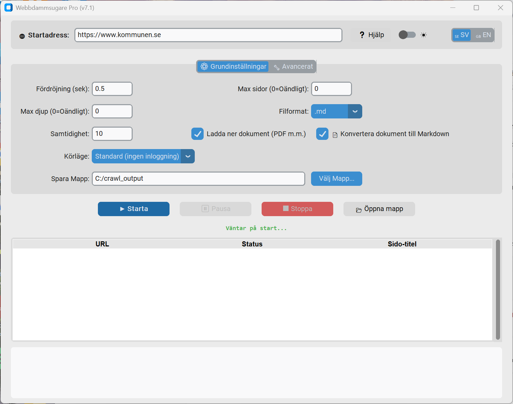

# 🕸️ Web Crawler Pro v7.1

[Svenska](README.md) | **English**



**Web Crawler Pro** (Swedish name: *Webbdammsugare Pro*) is a tool for scraping, structuring and storing website content, designed to produce high-quality text for AI models, retrieval-augmented generation (RAG) pipelines and vector databases. The GUI supports both Swedish and English.

---

## 🚀 Main features

### Crawling and networking

- **Asynchronous architecture:** Built on `asyncio` and `aiohttp`, with configurable concurrency (10 parallel pages by default) and separate Playwright semaphores (maximum 2).
- **Incremental crawling with conditional GET:** Stores `ETag`, `Last-Modified` and each page's outgoing links per URL. On a 304 response, cached links are replayed so child pages are still visited. Previously known pages and documents are also queued last when `incremental=true` and `max_depth=0`, even if their links have disappeared. Current URL filters and `max_pages` still apply. HTTP 404/410 removes the files and cache entry; for documents, this also removes the converted text. A full recrawl also cleans up visited 404/410 pages.
- **Change log and report:** Each run writes `changes.jsonl` (new, updated and removed pages/documents) and `crawl_report.json` (gaps, errors and warnings), supporting incremental synchronization with Svea.
- **Hybrid engine:** Fetches pages efficiently with aiohttp and falls back to Playwright when JavaScript rendering is needed.
- **CookieJar support:** Cookies obtained through Playwright login are injected into aiohttp with the correct domain, path and secure flags, supporting SAML/SSO.
- **Per-domain rate limiting:** Respects each host's `robots.txt` and `Crawl-Delay`, including sitemap requests and redirects. Automatically slows the affected host after 429/503 responses and gradually returns to the configured rate after successful responses, while preserving the `Crawl-Delay` floor.
- **Exponential backoff:** Retries 429/5xx responses with increasing delays and respects `Retry-After`.
- **Crawl trap protection:** Skips excessively deep paths, repeated path segments and URLs with too many query parameters. `max_pages` counts completed and in-flight pages, including when a large sitemap fills the queue.
- **Canonical URLs and duplicates:** Keeps the source page until the canonical target has been checked and a usable file exists in the same run. Unavailable, rejected and unchecked targets appear under `canonical_unresolved`. Duplicate decisions happen after page checks, preferring an existing published copy so that a changed or removed original does not hide a surviving copy.
- **Processing cache:** Changes to PII redaction, extraction, quarantine policy or output format require fresh fetching/processing, even with an ETag or old sitemap lastmod. Language and URL filters are checked separately during export and do not invalidate unchanged text. Changed titles and metadata are written even when the body is unchanged. Hashing preserves word boundaries. Older cache entries without a processing profile are checked again.
- **Sitemap `lastmod`:** Unchanged pages may be skipped while their links are replayed. The safety interval starts at the last real HTTP check (`checked_at`, 200 or 304), independently of the last body fetch (`fetched_at`) and last observation (`crawled_at`). Sitemap skips do not move the check time. After `sitemap_lastmod_max_age_days` (default 14), a new conditional GET is made. Older entries without a check time are rechecked. Rendered JavaScript pages are never skipped using sitemap lastmod, because their data can change without changes to the HTML shell.
- **Language filtering:** `languages` (for example `["sv"]`, or the GUI language filter) skips pages whose `<html lang>` specifies another language and does not follow their links.
- **Bot protection and soft 404s:** Cloudflare challenges and HTTP 200 pages saying that the page was not found are not saved as knowledge content.
- **Sitemap parser:** Handles XML, gzip-compressed `.xml.gz` files and recursive sitemap indexes in parallel, with loop protection.
- **Login detection:** Checks 401/403 responses or login pages against `session_check_url` (or the start page) before an expired session can stop the crawl. Configure an accessible protected resource if the start page is public. Permission denials appear under `access_denied`; unsuccessful session checks under `session_unverified`. Network errors prove neither a valid nor an expired session. Browser mode preserves HTTP status so 403/404/5xx pages do not become knowledge sources.
- **Priority URL queue:** Gives sitemap URLs higher priority, boosts words such as "policy" and "guide", and deprioritizes archives and news.
- **Batched database commits:** Commits every 25 changes or every 5 seconds, avoiding an fsync for every page.

### Content extraction

- **Trafilatura integration:** Text extraction for AI use, supporting Markdown, tables and links.
- **Semantic chunking:** Structured blocks of roughly 400 words with 50-word overlap, a heading, **heading path**, `context` (title plus heading path, with repetitions removed), content, chunk index and source URL. Tables keep their header when split across chunks; lists retain line breaks. PDF documents include `page_number` and a `page_url` deep link ending in `#page=X`.
- **Small sections:** Adjacent sibling sections are merged toward a minimum of 80 words, within the 400-word maximum. Headings remain in the text, and original paths are stored in `heading_paths`. Different parents, PDF pages, PowerPoint slides and Excel sheets stay separate. An isolated short section can still produce a small chunk.
- **CMS boilerplate removal:** Removes Sitevision interface content such as feedback widgets and publication footers from all output formats.
- **Visible metadata:** Markdown files include last-modified, retrieval-date and language information in the body, allowing questions about source freshness to be answered.
- **Clean page titles:** Removes a trailing site name: "Avgifter - Tyresö kommun" becomes "Avgifter".
- **Absolute Markdown links:** Resolves relative links and canonical URLs against the final URL after redirects and the first `<base href>`. Preserves the actual request URL separately from its deduplication key, including trailing slash and query. Current links can replace older queued cache addresses that have not yet been fetched.
- **Source URL in every chunk:** Includes the source URL for reliable RAG citations.
- **Sitevision-aware URL normalization:** Strips `sv.*`, `state` and `logout` parameters for stable deduplication.

### Document handling

- **Document downloads:** PDF, Word, Excel, PowerPoint, ZIP and other formats.
- **Documents to Markdown:** Extracts text from binary documents and saves `.md` files with source URLs in the body, supporting citations to the original source.
- **Document context:** Repeats the title and source on each PDF page/PowerPoint slide and when splitting long sections (roughly 400 words), so external chunkers also retain source information. PDF headings include the title and page number, for example `Taxa 2025 – sida 12`. JSONL retains `page_number`/`page_url`; PowerPoint chunks have `slide_number`.
- **Document dates:** `Hämtad` records when the stored original version was retrieved. `Dokumentets ändringsdatum`, `Skapad` and `Serverns ändringsdatum` describe file metadata and HTTP `Last-Modified`. Corresponding JSONL fields are `fetched_at`, `document_modified_at`, `created_at` and `server_modified_at`. Time zones are preserved when present. These technical dates are **not effective dates**; dates are not inferred from filenames. Unknown older retrieval dates remain empty, including after a 304. Changes to link descriptions or server dates update the text without downloading the original again.
- **PDF structure:** Uses font size/boldness cautiously for headings, reads clear two-column text bands column by column and preserves detected tables as Markdown. Repeated short margin lines are removed only when present on at least three pages and at least 60 percent of pages; repeated body text is retained. Table detection uses existing [PyMuPDF functionality](https://pymupdf.readthedocs.io/en/latest/page.html#Page.find_tables), with raw text retained on failure. Complex layouts still need review against reference documents.
- **PowerPoint:** Includes text in nested groups, tables and speaker notes, preserving slide numbers and table columns. Notes come from the [slide's notes_text_frame](https://python-pptx.readthedocs.io/en/latest/user/notes.html), excluding note-master headers and slide numbers. Word tables also preserve pipe characters and line breaks within cells.
- **Document titles:** Prioritizes link text, document metadata, filename and referring page title, in that order. Filters generic labels such as "Download", "Click here" and their Swedish equivalents.
- **Document manifest:** Links each downloaded document to the page that referenced it, allowing the RAG system to look up the correct intranet citation URL.
- **Automatic extension detection:** Derives extensions from Content-Type and Content-Disposition when the URL has no extension.
- **Safe downloads:** Writes to `.part` files and replaces the target atomically, enforces `max_download_mb` (default 100), and checks initial file bytes against the expected type. An HTML login page is never saved as a PDF.
- **Document updates:** Uses conditional GET when validators are available. Otherwise, downloads the content and compares SHA-256 hashes. Equal file size never proves unchanged content.
- **Version-linked document text:** Exports text only after successful conversion has been registered for the original's SHA-256 and current conversion/PII settings. Removes old text before switching original versions in the working directory. A later run retries failed conversion even after a 304. If a registered original has been changed locally, a fresh GET is made without old validators.
- **Isolated document processes:** PDF/Office/OCR runs in a bounded queue with separate processes, private temporary files and timeouts. Each job returns its own OCR/error diagnostics. Downloads continue during conversion; backpressure starts when the queue is full. Parser crashes do not damage the crawler process or later jobs. Windows uses [Job Objects](https://learn.microsoft.com/en-us/windows/win32/procthread/job-objects); other platforms use a separate process group so descendants also terminate on timeout/cancellation. LibreOffice receives its own profile and cannot attach the job to the user's open LibreOffice session.
- **Registered-file export:** Builds `chunks.jsonl` from registered pages with the current processing profile and version-checked document text, including `.txt`. Older unregistered or outdated processed text is moved to `texter_utgangna/` and listed under `retired_text_files`. Old page text is removed when a page is rejected, becomes too short, requires login, redirects outside allowed domains or becomes a binary document/image. Limited runs retain unvisited registered pages when processing settings are unchanged. After a PII/processing policy change, old text must be reprocessed before export. Publication safeguards described below prevent unconfirmed mass loss from replacing the active corpus.
- **Older-document migration:** Older text lacks a version link and must be reconverted when the original is checked again. Run an incremental crawl without page/depth limits after upgrading to refill the corpus. Unregistered older text remains in `texter_utgangna/` for review and must not be imported into Svea.
- **Legacy formats:** Converts `.doc`, `.xls`, `.ppt`, `.odt`, `.rtf` and related formats through LibreOffice when `soffice` is available. Word tables stay in document order; hidden Excel sheets are skipped.
- **OCR for scanned PDFs:** Reads pages without a text layer using Tesseract through PyMuPDF when installed; see the OCR section below. Text is marked `**Textkälla:** OCR` because recognition can introduce errors. Without Tesseract, scanned documents appear in `crawl_report.json` rather than silently disappearing.

### Other features

- **PII redaction for GDPR workflows:** Masks email addresses, phone numbers, Swedish personal identity numbers and IP addresses. Phone patterns handle `tel:` links, labels such as `Tfn:` and `Mobil:`, and parentheses while preserving case/reference numbers (for example `2024-0312-0012` and `KS/2024:0312-0012`), Swedish statute numbers and organization numbers. Redaction also covers link text, titles and document titles. Email, phone and personal-identity redaction are enabled by default in the GUI. `keep_role_emails=true` preserves role mailboxes such as `kontakt@` and `registrator@`. **Names are not masked; redaction does not replace a GDPR assessment.**
- **Prompt-injection detection and quarantine:** Flags matching patterns in page text, hidden elements and comments in `crawl_report.json`. Matching hidden elements are removed from the DOM; other hidden content such as accordions, tabs and FAQ panels is retained. Detection is heuristic and can produce false positives. Flagged text goes to `texter_karantan/` and its chunks to `chunks_quarantine.jsonl` when `quarantine_flagged_chunks` is enabled (default `true`).
- **Document checks:** Applies the same injection patterns to extracted document text and titles. Flagged text follows the same quarantine/JSONL policy; the original file is retained. Newlines in titles and metadata cannot inject fake source fields into Markdown/plain-text output.
- **Templates in `sites.json`:** GUI dropdown with preset settings.
- **Swedish/English GUI:** Switch interface language while the program is running.
- **Light/dark theme:** Toggle ☀️ / 🌙 without restarting.
- **Server mode (CLI):** Headless operation with JSON configuration and optional webhook notifications.

---

## ✅ Requirements

| Requirement | Details |
|---|---|
| **Python** | **3.11+** |
| **Chromium** | Installed using `playwright install chromium` (see below) |

> **Note:** Playwright downloads and manages its own Chromium instance. You do not need to install Google Chrome separately.

---

## 🛠️ Installation

**1. Clone the repository:**

```bash
git clone https://github.com/elementarpartikel/ultimate-web-crawler.git
cd ultimate-web-crawler
```

**2. Install dependencies:**

```bash
pip install -r requirements.txt
```

| Package | Purpose |
|---|---|
| `aiohttp` + `aiosqlite` | Asynchronous HTTP requests and database access |
| `beautifulsoup4` + `lxml` | HTML and XML parsing |
| `playwright` | JavaScript rendering with Chromium |
| `trafilatura` | Text extraction for AI use |
| `customtkinter` | GUI with light/dark themes |

**3. Install Playwright's browser** — required:

```bash
playwright install chromium
```

> Downloads Playwright's Chromium (approximately 150 MB). This only needs to be done once.

**4. Install optional document-conversion dependencies:**

```bash
pip install PyMuPDF python-docx openpyxl python-pptx
```

| Package | Purpose |
|---|---|
| `PyMuPDF` | PDF text extraction |
| `python-docx` | Word text extraction (.docx/.dotx) |
| `openpyxl` | Excel text extraction (.xlsx) |
| `python-pptx` | PowerPoint text extraction (.pptx) |

**5. Other optional dependencies:**

```bash
pip install uvloop brotli
```

| Package | Purpose |
|---|---|
| `uvloop` | Faster event loop (Linux/macOS only) |
| `brotli` | Brotli-compressed HTTP responses |

---

## 🖥️ Usage

```bash
python ultimate-web-crawler.py
```

### Templates

Place `sites.json` in the same directory as `ultimate-web-crawler.py` (or the packaged executable). A **📋 Template** dropdown appears automatically in the GUI. Select a template and click Start; settings are filled in and the output directory becomes a subdirectory based on the template name (for example `crawl_output/skolverket`).

The same `sites.json` works in server mode with `--config`; see Server mode below.

### GUI settings

**Basic settings:**

| Setting | Description |
|---|---|
| **Start URL** | Full URL, including `https://` |
| **Delay** | Seconds between requests per domain (default 0.5) |
| **Max pages** | `0` crawls the entire site |
| **Max depth** | Link depth from the start page (`0` is unlimited) |
| **Concurrency** | Parallel pages (default 10) |
| **File format** | See Output formats below |
| **Download documents** | Saves PDF, DOCX and other files under `dokument/` |
| **Convert documents to Markdown** | Extracts text into `.md` files with source URLs |
| **Run mode** | See Run modes below |
| **Full recrawl** (Advanced) | Ignores the cache and fetches everything again |
| **Folder** | Directory for saved output |

**Output formats:**

| Format | Description |
|---|---|
| **.json** | Structured data with headings, chunks and metadata; recommended for vector databases |
| **.md** | Markdown with source URLs in the body; suitable for RAG and LLM use. Default format |
| **.txt** | Plain text |
| **No text** | Crawls and downloads documents without saving page text |

**Run modes:**

| Swedish label | English label | Description |
|---|---|---|
| Standard (ingen inloggning) | **Standard (no login)** | Runs in the background without a visible browser, for sites that do not require login |
| Logga in först, sen automatiskt | **Log in first, then automatic** | Opens a visible browser for manual login, then continues in the background |
| Synlig webbläsare (felsökning) | **Visible browser (debugging)** | Shows the browser window to help inspect what happens |

**Advanced settings:**

| Setting | Description |
|---|---|
| **Hybrid engine** | Chooses aiohttp or Playwright per page |
| **Trafilatura** | Enables text extraction for AI use |
| **Sitemap.xml** | Loads sitemaps recursively, including gzip-compressed files |
| **robots.txt** | Respects crawling rules and Crawl-Delay |
| **Strict domain** | Restricts crawling to the configured domain |
| **Exclude words in URL** | Comma-separated list; matching URLs are skipped |
| **Require words in URL (any of)** | Visits only URLs containing at least one listed word (OR logic) |

**PII redaction (GDPR):**

| Setting | What is masked |
|---|---|
| **Remove email** | `kontakt@myndighet.se` → `[E-POST]` |
| **Remove phone numbers** | Swedish formats, including country code and parentheses → `[TELEFON]` |
| **Remove Swedish SSN** | Personal identity and coordination numbers → `[PERSONNUMMER]` |
| **Remove IP addresses** | IPv4 addresses → `[IP-ADRESS]` |

> 💡 Double-click any row in the *Live Data* table to open its URL in your browser.

---

## 💻 Server mode

Run headlessly with JSON configuration for scheduled operation using `cron` or Windows Task Scheduler:

```bash
python ultimate-web-crawler.py --config sites.json
python ultimate-web-crawler.py --config sites.json --webhook "https://hooks.slack.com/..."
```

> The webhook URL can also be set through `WEBHOOK_URL`. Up to three sites run in parallel. Each site gets its own subdirectory under `server_data/`. Override it with `--output DIR`, particularly in Task Scheduler where the working directory may differ.
>
> Server mode does **not** require tkinter/customtkinter and works on headless Linux. Exit code **0** means all sites succeeded; **1** means at least one site had a partial/failed run or invalid configuration; **2** means the configuration file could not be read. Page, document, conversion, robots.txt reachability and export errors therefore produce exit code 1. Unknown configuration keys produce a warning; a missing/invalid `start_url` skips that site.

### Server-mode login (`cookie_file`)

Interactive login requires the GUI. For scheduled intranet runs, set `headless_mode` to `login_then_headless` and `cookie_file` to a protected path such as `C:/secure/cookies.json`. First run a logged-in GUI crawl using the same `cookie_file` in its template; session cookies are saved there. Server mode reads them and verifies the session. Expired cookies stop the run with a clear error and exit code 1. **Treat the cookie file like a password.** After five consecutive confirmed session failures, the crawl stops rather than continuing without login.

### Advanced `sites.json` settings

| Key | Default | Description |
|---|---|---|
| `cookie_file` | – | Path for saving/loading session cookies |
| `user_agent` | `UltimateWebCrawler/7.1 (+repo-URL)` | Honest crawler identification; customize if needed |
| `allowed_domains` | `[]` | Additional domains considered part of the site with `strict_domain` |
| `include_subdomains` | `false` | Allows subdomains of the start domain |
| `max_page_mb` / `max_download_mb` | `10` / `100` | Page/document size limits |
| `max_path_segments` / `max_query_params` | `15` / `5` | Crawl trap limits |
| `keep_query_params` / `ignore_query_params` | `[]` | Controls URL parameters removed during deduplication; defaults include `state`, `ref`, `source` and `sv.*` |
| `boost_words` / `penalty_words` | see code | URL words that increase/decrease priority |
| `keep_role_emails` | `false` | Preserves role mailboxes such as `kontakt@` during email redaction |
| `ignore_https_errors` | `false` | Ignores browser certificate errors, for example with an intranet's own CA |
| `allow_private_hosts` | automatic | Allows private IPs; enabled automatically when the start address is private/an intranet |
| `incremental` | `true` | `false` performs a full recrawl |
| `session_check_url` | start page | Accessible protected resource for verifying login; configure if the start page is public |
| `languages` | `[]` (all) | Only these languages, for example `["sv"]` |
| `respect_canonical` | `true` | Avoids saving copies of pages that identify another URL as the original |
| `dedupe_content` | `true` | Keeps one copy of pages with identical content |
| `use_sitemap_lastmod` | `true` | Skips pages reported unchanged by the sitemap |
| `sitemap_lastmod_max_age_days` | `14` | Rechecks older entries even when lastmod is unchanged |
| `export_jsonl` | `true` | Writes `chunks.jsonl`, one chunk per line |
| `quarantine_flagged_chunks` | `true` | Separates flagged chunks, such as possible prompt injection, into `chunks_quarantine.jsonl` instead of `chunks.jsonl` |
| `ocr` / `ocr_languages` / `ocr_max_pages` | `true` / `swe+eng` / `50` | Scanned-PDF OCR; requires Tesseract |
| `conversion_workers` | `2` | Concurrent document processes per site, independent of fetch `concurrency` |
| `conversion_queue_size` | `8` | Maximum waiting conversion jobs; running processes are counted separately |
| `conversion_timeout` | `180` | Seconds per worker, including startup/imports; increase for large scans. Timeout/cancellation also terminates descendants |
| `generation_keep` | `0` | Optional history cleanup: `0` keeps all; `10` keeps the current generation and nine latest older generations, plus those within the grace period |
| `generation_min_age_hours` | `24` | Grace period from when a generation is first recorded as inactive; must exceed the longest RAG import that pins a generation |

Keep `ultimate-web-crawler.py`, `crawler_runtime.py`, `conversion_worker.py`, `document_conversion.py` and `crawler_text.py` in the same directory when running source code. Worker startup also supports `pythonw` and an internal entry point for packaged programs. Conversion and generation settings work in the CLI and are preserved when selecting a GUI template. PDF workers load only the PDF parser, without GUI, HTML/network libraries or Office parsers.

Missing delay, page/depth limit and concurrency settings receive defaults of `0.5`, `0`, `0` and `10`/`2`. Numeric strings are normalized; negative values, NaN/infinity, invalid integers and incorrect list/boolean types are rejected before crawling. Both `exclude_keywords` and `require_keywords` match case-insensitively in GUI and CLI.

### Example `sites.json`

These examples cover RAG text extraction, document downloads with Markdown conversion, and intranet crawling with login. Swedish site names and URL-filter words are retained because the example websites are Swedish. `save_format` accepts both `"Ingen text"` and `"No text"` for document-only crawling.

```json
[
  {
    "name": "Skolverket (RAG & AI-text)",
    "start_url": "https://www.skolverket.se",
    "delay": 0.5,
    "max_pages": 500,
    "max_depth": 3,
    "concurrency": 10,
    "save_format": ".md",
    "headless_mode": "headless",
    "find_sitemap": true,
    "respect_robots": true,
    "use_hybrid": true,
    "use_trafilatura": true,
    "download_docs": false,
    "convert_docs_to_md": false,
    "strict_domain": true,
    "exclude_keywords": ["images", "login", "kalender"],
    "require_keywords": [],
    "remove_email": true,
    "remove_phone": true,
    "remove_pnr": true,
    "remove_ip": false
  },
  {
    "name": "SKR (Dokument + Markdown)",
    "start_url": "https://skr.se",
    "delay": 0.5,
    "max_pages": 500,
    "max_depth": 1,
    "concurrency": 10,
    "save_format": "Ingen text",
    "headless_mode": "headless",
    "find_sitemap": true,
    "respect_robots": true,
    "use_hybrid": true,
    "use_trafilatura": false,
    "download_docs": true,
    "convert_docs_to_md": true,
    "strict_domain": true,
    "exclude_keywords": [],
    "require_keywords": [],
    "remove_email": false,
    "remove_phone": false,
    "remove_pnr": false,
    "remove_ip": false
  },
  {
    "name": "Kommun-intranät (inloggning)",
    "start_url": "https://intranat.kommun.se",
    "delay": 1.0,
    "max_pages": 0,
    "max_depth": 0,
    "concurrency": 5,
    "save_format": ".md",
    "headless_mode": "login_then_headless",
    "find_sitemap": true,
    "respect_robots": false,
    "use_hybrid": true,
    "use_trafilatura": true,
    "download_docs": true,
    "convert_docs_to_md": true,
    "strict_domain": true,
    "exclude_keywords": ["logout", "kalender", "arkiv"],
    "require_keywords": [],
    "remove_email": true,
    "remove_phone": true,
    "remove_pnr": true,
    "remove_ip": true
  }
]
```

---

## 📂 Output structure

Folder names remain the same in both interface languages. Placeholder filenames below illustrate generated page/document names.

```text
crawl_output/
├── current.json                     # Atomic entry point to the published generation
├── .generations/<id>/               # Complete generation: text, originals, index, manifest, chunks and report
├── .working/<id>/                   # In-progress run; never an import source
├── texter/                          # One file per approved page
│   ├── page_name_a1b2c3d4.md        # Or .json / .txt
│   └── document_name_a1b2c3d4_doc.md # Converted documents
├── texter_karantan/                 # Quarantined text, e.g. possible prompt injection
├── dokument/                        # Downloaded PDF, DOCX, XLSX and other files
├── logs/
│   └── crawl_YYYYMMDD_HHMMSS.log
├── index.csv                        # URL, title, date and filename; existing files only
├── chunks.jsonl                     # Clean chunks, ready for Svea/vector-database import
├── chunks_quarantine.jsonl          # Separate chunks from flagged sources
├── changes.jsonl                    # New/updated/removed resources; appended each run
├── crawl_report.json                # Gaps, errors, warnings and sources not seen since the previous run
├── manifest_domainname.json         # Links documents to their referring pages
└── domainname_cache.db              # SQLite cache for incremental crawling
```

### Consistent imports through `current.json`

The crawler prepares a complete delivery in a working directory and replaces `current.json` only after conversions, index, manifest, corpus and report are ready. A `failed` run, export error or cancellation before commit leaves the previous generation and its cache intact. A completed run with isolated fetch/conversion errors can publish a clean `partial` generation with error details in the report; CLI exit code remains 1. A commit that has already started is completed even if its wait is cancelled.

Unreachable robots.txt stops new fetches on the affected origin but does not remove saved content. Robots fetching retries up to twice. Public 401/403 responses are fetch failures and retain previous sources. If more than half the previous generation's clean source files disappear without evidence, publication stops and `publication_blocked` explains the loss. Real HTTP 404/410 responses, explicit selection/processing changes, quarantine and confirmed duplicate decisions can explain removals. A soft 404 or short HTTP 200 page does not justify mass deletion. A site confirmed to be empty can therefore publish an empty corpus.

Processing profiles cover PII redaction, format, quarantine policy and extractor. URL/language selection and fetch engine are outside the profile; selection is checked separately at export, including unvisited sources. When upgrading from older page/document profiles without a profile description, a limited first run may be stopped by the loss safeguard. Run once with `max_pages=0` and `max_depth=0` so sources can be reprocessed. The previous delivery remains available meanwhile.

For Svea/RAG, **read `current.json` once and use the same generation directory for the entire import**:

```python
from pathlib import Path
import json

root = Path("crawl_output")
pointer = json.loads((root / "current.json").read_text(encoding="utf-8"))
generation = root / pointer["generation"]
if pointer["corpus"] is not None:
    corpus_path = generation / pointer["corpus"]
    # Read chunks.jsonl, index.csv and manifests from this generation directory.
```

`generation.json` describes that delivery. `artifacts` lists delivery files, excluding the cache and retired-text archives. `corpus` points to clean chunks; `quarantine` is separate and must not enter the regular corpus. With `export_jsonl=false`, `corpus` is empty and old JSONL files are removed from the new delivery.

Legacy top-level paths (`texter/`, `chunks.jsonl`, `index.csv` and manifests) remain as compatibility copies. They are **not** replaced together atomically; integrations must use the generation directory for the consistency guarantee. Copies do not share hard links with the generation and cannot modify it. A failed compatibility-copy update produces an error status while the complete published generation remains available.

The top-level `crawl_report.json` describes the latest attempt, with `publication_committed` and `published_generation`. The report inside a generation belongs to that delivery. The next run restores its cache from the published generation. The output directory is locked against concurrent writers; abandoned working directories are cleaned on restart. Previous generations are retained by default for pinned readers. Scheduled deployments can enable cleanup with, for example, `generation_keep=10` and `generation_min_age_hours=24`; set a grace period longer than the readers' maximum import time. The current generation and N latest generations stay protected; the grace period may temporarily retain more than N directories. Cleanup appears in `generation_cleanup`; `generation_cleanup_failures` reports cleanup errors separately without rolling back a complete delivery. This cleanup does not cover text archives or logs. Retired text archives must not enter RAG imports.

`crawl_report.json.status` is `success` when no run errors occurred, `partial` when at least one resource was fetched/checked but others failed or the run stopped, and `failed` for fatal errors or a run with errors in which nothing succeeded. Export errors are always fatal. Intentional limits such as `max_pages`, normal removals and robots exclusions are not run errors. `completed_naturally` independently indicates whether the queue was emptied. The report is also written when login fails before crawling begins.

Robots rules are loaded separately per scheme, host and port and checked before the start page and every redirect. A robots.txt 4xx response permits fetching; 5xx/network failure stops fetching on the affected origin and appears under `robots_unreachable`, following [RFC 9309](https://www.rfc-editor.org/rfc/rfc9309.html#section-2.3.1). `robots_denied` lists blocked URLs. Sitemap discovery also works with `respect_robots=false`.

Document browser fallback is used only in `login_then_headless` after a 401/403 or HTML response. Chromium streams attachments and inline documents under `max_download_mb`; oversized transfers are aborted and temporary files removed. Native browser downloads are disabled so they cannot bypass the limit.

### JSON output per page

These output examples retain Swedish source text and fixed metadata labels used by the crawler. The GUI language does not translate website content or change output field names.

```json
{
  "title": "Kontakta oss - Skolverket",
  "url": "https://www.skolverket.se/kontakt",
  "crawled_at": "2026-04-03T12:00:00",
  "author": "",
  "published_date": "",
  "modified_date": "2026-03-15",
  "language": "sv",
  "og_type": "",
  "description": "Så når du Skolverket",
  "keywords": ["kontakt"],
  "flags": [],
  "plain_text": "## Ring oss\nNi når oss på [TELEFON]...",
  "chunks": [
    {
      "heading": "Ring oss",
      "heading_path": "Ring oss",
      "context": "Kontakta oss > Ring oss",
      "content": "Ni når oss på [TELEFON]. Vår e-post är [E-POST].",
      "chunk_index": 1,
      "total_chunks": 3,
      "url": "https://www.skolverket.se/kontakt"
    }
  ]
}
```

### Markdown output per page

Metadata labels include `Källa` (source), `Senast ändrad` (last modified), `Hämtad` (retrieved) and `Språk` (language).

```markdown
# Kontakta oss - Skolverket

**Källa:** https://www.skolverket.se/kontakt
**Senast ändrad:** 2026-03-15
**Hämtad:** 2026-04-03
**Språk:** sv

---

## Ring oss
Ni når oss på [TELEFON]. Vår e-post är [E-POST].

---

**Källa:** https://www.skolverket.se/kontakt
```

### Converted document (Markdown)

`Dokument-URL` is the document URL, `Filnamn` the filename and `Filtyp` the file type. The abbreviated example below shows the source blocks; full output also includes available dates and repeated context within the document.

```markdown
# Budget 2025

**Källa:** https://intranat.kommun.se/ekonomi
**Dokument-URL:** https://intranat.kommun.se/download/budget-2025.pdf
**Filnamn:** budget-2025.pdf
**Filtyp:** PDF

---

## Sida 1

[dokumenttext...]

---

**Källa:** https://intranat.kommun.se/ekonomi
**Dokument-URL:** https://intranat.kommun.se/download/budget-2025.pdf
```

---

## 📦 chunks.jsonl — importing into Svea/vector databases

After each run, `chunks.jsonl` is built from all approved pages and documents, including unchanged ones, to provide the complete approved corpus for Svea. Source text files and chunks with possible prompt injection or other security flags are separated into `texter_karantan/` and `chunks_quarantine.jsonl`. Each line is a record:

```json
{"id": "a1b2c3d4e5-1", "url": "https://…/avgifter", "title": "Avgifter", "source_type": "page",
 "referer_url": "", "language": "sv", "modified_date": "2026-03-15", "crawled_at": "2026-04-03",
 "heading": "Förskola", "heading_path": "Avgifter > Förskola", "context": "Avgifter > Förskola",
 "content": "…", "chunk_index": 1, "total_chunks": 4, "flags": []}
```

For documents, `source_type` is `document`, `url` is the document address and `referer_url` is the referring page. PDF chunks include `page_number` (for example 14) and `page_url`, such as `https://…/policy.pdf#page=14`; PowerPoint chunks include `slide_number`. Merged sections include the original `heading_paths`. An ID combines the source hash and chunk sequence number: the source portion is stable, but changes to chunking can move content between IDs. Replace all chunks for an updated source and remove old IDs using `changes.jsonl` and the file registry.

---

## 🔍 OCR for scanned PDFs

Many municipal PDFs are scans without a text layer. To read them:

1. Install **Tesseract** (on Windows, use the UB Mannheim installer), select the required language data, including Swedish for `swe+eng`, and add it to `PATH`.
2. The crawler detects it automatically. Pages without text are OCR-processed, with up to `ocr_max_pages` attempts per document (default 50). Failed attempts count toward the limit because OCR is expensive.

If Tesseract is unavailable, scanned documents appear under `conversion_failures` in `crawl_report.json` with a reason. OCR text can contain errors and is labelled accordingly.

---

## 🔒 Security and data protection

- **Access control:** When crawling an intranet with a user's login, everything that account can access may enter the output and become accessible to Svea users. Use a dedicated account with minimal permissions and review what is imported.
- **Network protection:** aiohttp checks IP literals and DNS results, including redirects. For public start addresses, Chromium uses a local SOCKS5 proxy that checks every TCP target and connects to the exact validated IP. This covers rendering, redirects, popups, interactive login and browser downloads. Implicit loopback bypass, QUIC and WebRTC traffic outside the proxy are disabled; Service Workers are blocked. Browser documents stream through CDP with a size limit; Playwright's separate request API is not used. Proxy failure never triggers an unprotected direct connection. Intranet starts or explicit `allow_private_hosts=true` permit private network targets.
- **Limits:** Bounds page/download sizes and decompressed sitemaps. XML containing entities is rejected.
- **HTTPS:** Browser certificate errors are ignored only with explicit `ignore_https_errors` configuration.
- **Cookie files:** `cookie_file` is equivalent to a password. Its contents are never logged; keep it in a protected directory.
- **Untrusted LLM input:** Pages can contain hidden instructions or CSS targeting AI systems. Matching hidden instructions are removed before saving, flagged under `possible_prompt_injection` in `crawl_report.json`, and their chunks placed in `chunks_quarantine.jsonl` rather than the main corpus. The detector remains heuristic.
- **Document parsing:** PDF/Office/OCR runs in isolated worker processes with time limits and private input copies. This isolates parser crashes but is not an operating-system sandbox. Keep size limits and access controls.

---

## 🧪 Tests

```bash
pip install pytest
python -m pytest tests -q
```

Tests use local servers without crawling live sites. Coverage includes `max_pages` with sitemaps, incremental crawling, page deletion, document updates, SSRF protection, bot pages, server mode without tkinter and exit codes. Real Chromium tests cover JavaScript rendering, login flows and download fallback. PDF, Word, Excel and PowerPoint are tested in real worker processes. Real OCR/LibreOffice integration tests run when the required tools/language data are installed; they are skipped in this environment. Wiring is also tested with substitutes.

`tests/test_corpus_integrity.py` additionally covers prolonged lastmod skipping, same-size changed documents, retries after conversion failures, unlinked deleted sources, full recrawls, rejected pages, cache migration and export registration. `tests/test_network_guard.py` checks DNS pinning, Chromium redirects, subresources, popups and downloads using a fully local simulated public host.

`tests/test_second_round.py` covers URL bases/redirects, settings-dependent cache profiles, metadata updates, canonical URLs and duplicates, CLI defaults/validation, permission-restricted sections and session checks, document quarantine, plain-text output and browser status. Proxy tests also cover clients accepted just before shutdown whose handlers have not yet started.

## Status after six review rounds (2026-10-12)

Round one fixed network protection, freshness, document versions and corpus cleanup. Round two fixed URL handling, page processing caches and metadata, canonical/duplicate handling, 403/session checks, configuration validation, document injection detection and `.txt` export. It also addressed ignored browser status, lastmod hiding changed JavaScript pages and metadata spoofing source fields.

Round three fixed run status/CLI exit codes, silent export failures, atomic index/change-log writes, robots handling per origin including the start page and redirects, sitemap discovery when robots enforcement is disabled, sitemap rate limiting, adaptive-delay recovery and bounded browser-document streaming. The proxy uses raw asynchronous sockets with explicit closing to avoid a Windows hang after reset connections while preserving DNS pinning.

Round four added document dates with provenance, correct retrieval dates after 304, reconversion after link/date metadata changes, repeated context in long documents, PDF headings/tables/two-column order and cautious margin removal, small sibling chunks and PowerPoint groups/tables/speaker notes. Failed OCR attempts count toward the limit. JSONL distinguishes PDF page numbers from PowerPoint slide numbers and retains merged heading paths. Older conversions/processing profiles are reconsidered when their sources are next visited.

Round five isolated PDF/Office/OCR in a bounded process queue with timeouts, descendant cancellation and copied-input version checks. Fetch concurrency is freed during conversion. Corpus, index, manifest, originals and cache are prepared as one generation committed through atomic `current.json` replacement. Cancellation before commit retains the previous delivery; restarts use its cache and clean working directories. Legacy paths are compatibility copies, and importers must pin a generation for consistent reads. `tests/test_fifth_round.py` covers real processes, hard crashes, timeouts, descendants, backpressure, cancellation, publication failures and recovery.

Round six fixed publication during outages: `failed` never becomes `current.json`; robots outages cannot empty the export; public 403 retains old text; large unexplained loss blocks publication. Normal HTTP deletion can publish an empty site when there are no other errors. Processing profiles are separated from selection settings. Unlined PDF price lists retain label/amount pairing without interleaving subsequent prose columns. Conversion moved into a lightweight module with parsers loaded by file type. Five local startup measurements gave medians of 1.025 s before and 0.250 s for the PDF worker after; this measures startup/imports, not conversion time. Unchanged originals are hashed once per run and checked hashes reused at export; the cache deliberately does not persist across runs. Session probes are shared for one minute, adaptive slowdown affects only the relevant host, and optional generation cleanup includes a grace period. `tests/test_sixth_round.py` covers these cases, including real connection failure, recovery and profile migration.

Final verification after round six: **266 tests passed, 2 skipped** because real OCR/LibreOffice tools are unavailable here. Tests use local servers and worker/browser processes; no live sites are crawled.

Remaining work:

- **OCR/LibreOffice verification:** Run integration tests with the actual tools and language data when installed. Wiring and process boundaries are verified here; the two real-tool tests are skipped.
- **Advanced PDF quality:** Evaluate pymupdf4llm against real municipal reference documents, particularly layouts with more than two columns, unlined/cross-page tables, complex typography and mixed OCR. Current improvements use existing PyMuPDF and synthetic references. Effective dates must still be read from content; technical metadata dates do not replace them.
- **Injection detection:** Review false positives and improve quarantine-report evidence.
- **Performance:** Reuse lxml trees for HTML extraction, parse large sitemaps outside the event loop and reduce repeated link validation without losing document references. Sitemap cache hits no longer wait on rate limiting. Measure improvements before larger rewrites.

---

## ⚖️ Ethics and responsibility

This tool is intended for lawful and ethical data collection. Users are responsible for:

- Following website terms of use.
- Avoiding excessive server load by using the built-in delay and rate limiter.
- Respecting `robots.txt`. The crawler identifies itself as `UltimateWebCrawler` and supports wildcard/terminal rules with `protego` installed.
- Ensuring collected data is handled in accordance with GDPR and other applicable rules.
