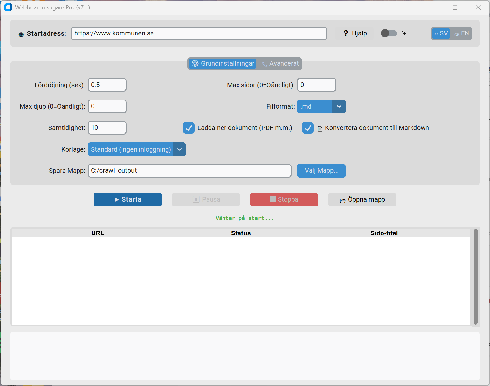

# 🕸️ Webbdammsugare Pro / Web Crawler Pro v7.1

**Svenska** | [English](README.en.md)



**Webbdammsugare Pro** är ett professionellt verktyg för att skrapa, strukturera och lagra innehåll från webbplatser – särskilt framtaget för att generera högkvalitativ textdata för AI-modeller, RAG-pipelines och vektordatabaser.

---

## 🚀 Huvudfunktioner

### Crawlning & Nätverk
- **Ren async-arkitektur:** Byggd på `asyncio` och `aiohttp` med valbar samtidighet (standard 10 parallella sidor) och separata Playwright-semaforer (max 2).
- **Inkrementell crawl med conditional GET:** Sparar `ETag`, `Last-Modified` *och sidans länkar* per URL. Vid 304 spelas länkarna upp så att undersidorna ändå besöks. Tidigare kända sidor och dokument läggs dessutom sist i kön när `incremental=true` och `max_depth=0`, även om länkarna till dem har försvunnit. Aktuella URL-filter och `max_pages` gäller fortfarande. 404/410 tar bort både filerna och cacheposten; för dokument tas även den konverterade texten bort. Full omcrawl städar också besökta 404/410-sidor.
- **Ändringslogg och rapport:** Varje körning skriver `changes.jsonl` (ny / ändrad / borttagen sida och dokument) och `crawl_report.json` (luckor, fel och varningar) – tänkt som underlag för att uppdatera en kunskapsbas för RAG inkrementellt.
- **Hybridmotor:** Hämtar sidor snabbt med aiohttp och faller automatiskt tillbaka på Playwright bara när sidan kräver JavaScript-rendering.
- **Riktig CookieJar:** Cookies från Playwright-inloggningen injiceras i aiohttp med korrekt domän/path/secure-flaggor via SAML/SSO-stöd.
- **Per-domän rate limiter:** Respekterar `Crawl-Delay` från varje värds `robots.txt`, också för sitemaps och redirects. Saktar ner automatiskt vid 429/503 och återgår gradvis till inställd takt efter lyckade svar, utan att underskrida `Crawl-Delay`.
- **Omförsök:** Dokumenthämtning via HTTP gör upp till två omförsök efter 429, 500, 502, 503, 504 och tillfälliga anslutnings- eller strömfel. Varje försök följer värdens hastighetsgräns. `Retry-After` för dokument kan anges i sekunder eller som HTTP-datum. Ber servern om mer än 60 sekunders väntan avslutas dokumenthämtningen för körningen. Vid uttömda försök rapporteras ett hämtningsfel och föregående dokumentversion behålls.
- **Skydd mot crawl-fällor:** Hoppar över extremt djupa sökvägar, upprepade sökvägssegment och URL:er med många query-parametrar. `max_pages` räknar färdiga *och* pågående sidor, även när kön fyllts från en stor sitemap.
- **Canonical och dubbletter:** källsidan behålls tills canonical-målet kontrollerats och en användbar fil finns i samma körning. Otillgängliga, avvisade och ännu inte kontrollerade mål listas under `canonical_unresolved`. Dubblettbeslut tas efter sidkontrollerna, med befintlig publicerad kopia som förstahandsval, så att ett ändrat eller borttaget original inte döljer en fungerande kopia.
- **Bearbetningscache:** ändrad PII-tvätt, extraktion, karantänpolicy eller utdataformat kräver ny hämtning/bearbetning även med ETag eller gammal sitemap-lastmod. Språk-/URL-filter kontrolleras separat vid export och ogiltigförklarar inte oförändrad text. Ändrad titel och metadata skrivs ut även när brödtexten är densamma. Ordgränser bevaras vid hashning. Äldre cacheposter utan bearbetningsprofil kontrolleras igen.
- **Sitemapens `lastmod`:** oförändrade sidor kan hoppas över och deras länkar spelas upp. Säkerhetsventilen räknar från senaste verkliga HTTP-kontroll (`checked_at`, 200 eller 304), separat från senast hämtade innehåll (`fetched_at`) och senast sedd sida (`crawled_at`). Sitemap-hopp flyttar inte kontrolltiden. Efter `sitemap_lastmod_max_age_days` (standard 14) görs en ny villkorlig GET. Äldre cacheposter utan kontrolltid kontrolleras igen. Renderade JavaScript-sidor hoppas aldrig över via sitemap-lastmod, eftersom deras data kan ändras utan att HTML-skalet ändras.
- **Språkfilter:** `languages` (t.ex. `["sv"]`, eller fältet "Bara språk" i GUI:t) hoppar över sidor vars `<html lang>` är ett annat språk – och följer inte deras länkar.
- **Bot-skydd och soft-404:** Cloudflare-utmaningar och "Sidan hittades inte"-sidor med statuskod 200 sparas inte som innehåll.
- **Sitemap-läsning:** Packar upp gzip och tolkar XML utanför eventloopen. Sitemap-index följs breddvis med högst fyra samtidiga hämtningar och tolkningar samt högst 500 unika sitemaps per körning. Samma värds anrop följer hastighetsgränsen och XML med DTD eller entitetsdeklarationer avvisas.
- **Login-detektor:** 401/403 eller inloggningssidor kontrolleras mot `session_check_url` (eller startsidan) innan en utgången session kan avbryta crawlen. Ange en åtkomlig inloggningsskyddad resurs om startsidan är publik. Nekad behörighet listas under `access_denied`, misslyckad sessionskontroll under `session_unverified`; nätverksfel bevisar varken giltig eller utgången session. HTTP-status bevaras även i browser-läge så att 403/404/5xx-sidor inte blir kunskapskällor.
- **Prioriterad URL-kö:** URL:er från sitemap ges högre prioritet. Kön boostar URL:er med ord som "policy", "guide" och nedprioriterar arkiv och nyheter.
- **Batched DB-commits:** Skrivningar samlas och commitas var 25:e ändring eller var 5:e sekund – eliminerar fsync per sida.

### Innehållsextraktion
- **Trafilatura-integration:** AI-optimerad textextraktion med stöd för Markdown, tabeller och länkar.
- **Semantisk chunkning:** Strukturerade block (~400 ord, 50 ords överlappning) med rubrik, **rubrikväg** (`Skola > Förskola > Avgifter`), `context` (titel + rubrikväg, deduplicerad mot stutter), innehåll, chunk-index och käll-URL per chunk. Tabeller behåller sitt tabellhuvud även vid uppdelning över flera chunks, och listor behåller radbrytningar. PDF-dokument får sidnummer (`page_number`) och djuplänk (`page_url` med `#page=X`).
- **Små sektioner:** Intilliggande syskonsektioner slås ihop mot minst 80 ord, inom gränsen 400 ord. Rubrikerna finns kvar i texten och de ursprungliga rubrikvägarna i `heading_paths`. Olika föräldrar, PDF-sidor, PowerPoint-bilder och Excel-blad hålls isär. Ensamma korta sektioner kan fortfarande bli små chunks.
- **HTML- och Excel-tabeller:** BeautifulSoup-reservvägen och Excel-konverteringen fyller ut korta rader med tomma celler så att alla rader har samma antal kolumner. Lodstreck i cellvärden skrivs som `\|` och explicita radbrytningar som `<br>`. När en tabell delas över flera chunks följer tabellhuvudet med. Sid- och dokumentprofilerna har versionshöjts så att sparade texter bearbetas på nytt när källorna besöks igen.
- **CMS-boilerplate-rensning:** Automatisk borttagning av Sitevision-chrome (feedback-widget, "Sidan publicerad av" etc.) i *alla* utdataformat.
- **Metadata i brödtexten:** `.md`-filer innehåller **Senast ändrad**, **Hämtad** och **Språk** som synlig text, så att frågor om hur aktuell en sida är kan besvaras.
- **Sidtitel utan sajtnamn:** "Avgifter - Tyresö kommun" blir "Avgifter".
- **Absoluta Markdown-länkar:** Relativa länkar och canonical tolkas mot URL:en efter redirects och sidans första `<base href>`. Faktisk hämtnings-URL bevaras separat från dubblettnyckeln, inklusive trailing slash och query. Aktuella länkar får ersätta köade äldre cacheadresser som ännu inte hämtats.
- **URL i varje chunk:** Käll-URL:en injiceras i varje chunk för robustare RAG-källhänvisning.
- **URL-normalisering:** Tar bort kända spårningsparametrar och Sitevision-parametrar som `sv.*` och `logout`. `ref`, `source` och `state` behålls som standard eftersom de kan välja innehåll.

### Dokumenthantering
- **Dokumentnedladdning:** PDF, Word, Excel, PowerPoint, ZIP m.fl.
- **Dokument → Markdown-konvertering:** Extraherar text ur binära dokument och sparar som `.md` med käll-URL i brödtexten – perfekt för RAG-system som behöver citera rätt källa.
- **Dokumentkontext:** Titel och källa upprepas per PDF-sida/PowerPoint-bild och vid uppdelning av långa avsnitt (~400 ord), så att även extern chunkning får källinformation. PDF-sidor har rubriker som `Taxa 2025 – sida 12`; JSONL behåller korrekt `page_number`/`page_url`. PowerPoint-chunks får `slide_number`.
- **Dokumentdatum:** `Hämtad` beskriver den lagrade originalversionens hämtningstid. `Dokumentets ändringsdatum`, `Skapad` och `Serverns ändringsdatum` beskriver filmetadata respektive HTTP `Last-Modified`. JSONL har motsvarande fält `fetched_at`, `document_modified_at`, `created_at` och `server_modified_at`. Tidszoner bevaras när de finns. De tekniska datumen är **inte giltighetsdatum**; inga datum härleds ur filnamn. Äldre okänd hämtningstid lämnas tom även vid 304. Ändrad länkbeskrivning eller serverdatum uppdaterar texten utan att behöva ladda ner originalet igen.
- **PDF-struktur:** Typsnittsstorlek/fetstil används försiktigt för rubriker, tydliga tvåspaltsband läses spaltvis och identifierade tabeller bevaras som Markdown. Återkommande korta rader i sidmarginalerna tas bort först när de finns på minst tre och minst 60 procent av sidorna; likadan text i brödtexten bevaras. Tabellidentifiering använder befintlig [PyMuPDF](https://pymupdf.readthedocs.io/en/latest/page.html#Page.find_tables); vid fel behålls råtexten. Komplexa layouter behöver fortfarande granskas mot referensdokument.
- **PowerPoint:** Texter i nästlade grupper, tabeller och talarnoteringar tas med; bildnummer och tabellkolumner bevaras. Noteringar läses ur [bildens notes_text_frame](https://python-pptx.readthedocs.io/en/latest/user/notes.html), utan sidhuvud och bildnummer från anteckningsmallen. Word-tabeller bevarar också pipe-tecken och radbrytningar i cellerna.
- **Smart titelextraktion:** Prioriterar länktext → dokumentmetadata → filnamn → sidtitel. Filtrerar bort generiska texter som "Ladda ner fil", "Download", "Klicka här".
- **Dokument-manifest:** `manifest.json` kopplar varje nedladdat dokument till den sida som hade länken – RAG-systemet kan slå upp rätt intranät-URL.
- **Filtyp och filtypsbyten:** Kontrollerar nedladdningens signatur och, för ZIP-baserade format, paketets struktur. Content-Type, Content-Disposition och URL ger ledtrådar. Ett verifierat typbyte på samma URL behåller filnamnets stam, byter ändelse och ersätter originalet och dess cachepost i nästa generation. `document_updated` anger också `previous_file` vid namnbyte. En ogiltig nedladdning behåller föregående dokumentversion. Äldre Word-, Excel- och PowerPoint-format delar en signatur och behöver därför också en typuppgift. För innehåll utan unik signatur behålls den tidigare ändelsen. ZIP-katalogen får vara högst 4 MiB vid typkontrollen.
- **Säkra nedladdningar:** HTTP och webbläsarens reservväg strömmar till `.part` med storleksgränsen `max_download_mb` (standard 100). Filtypskontrollen sker före det atomära filbytet.
- **Uppdaterade dokument:** Villkorlig GET används när servern har validatorer. Utan validatorer hämtas innehållet och jämförs med SHA-256; samma filstorlek räcker aldrig för att anta att dokumentet är oförändrat.
- **Versionskopplad dokumenttext:** Text får exporteras först när en lyckad konvertering registrerats för originalfilens SHA-256 och aktuella konverterings-/PII-inställningar. Gamla texter tas bort före byte till en ny originalversion i arbetsmappen. Efter konverteringsfel försöker nästa körning igen även vid 304. Om en registrerad originalfil har ändrats lokalt används en ny GET utan gamla validatorer.
- **Separata dokumentprocesser:** PDF/Office/OCR körs i en begränsad kö med egna processer, egna temporära filer och timeout. Varje jobb returnerar sin egen OCR-/feldiagnostik. Hämtningar fortsätter medan konvertering pågår; först när kön är full blir det backpressure. Parserkrasch skadar inte crawlerprocessen eller efterföljande jobb. Windows använder [Job Objects](https://learn.microsoft.com/en-us/windows/win32/procthread/job-objects), övriga plattformar en separat processgrupp, så att också barnprocesser avslutas vid timeout/avbrott. LibreOffice får en egen profil och kan därför inte koppla jobbet till användarens öppna LibreOffice-session.
- **Export från filregistret:** `chunks.jsonl` byggs från registrerade sidfiler med aktuell bearbetningsprofil och versionskontrollerade dokumenttexter, även för `.txt`. Äldre oregistrerade eller inaktuellt bearbetade texter flyttas till `texter_utgangna/` och listas under `retired_text_files`. Tidigare sidtexter tas bort när sidan avvisas, blir för kort, kräver inloggning eller blir ett binärt dokument/en bild. Otillåtna redirects räknas som hämtningsfel och behåller föregående text. En begränsad körning behåller obesökta registrerade sidor när bearbetningsinställningarna är oförändrade. Efter ändrad PII-/bearbetningspolicy exporteras en gammal text först när den bearbetats om.
- **Migrering av äldre dokument:** Äldre dokumenttexter saknar versionskoppling och måste konverteras om när originalet återkontrolleras. Kör gärna en inkrementell körning utan sid-/djupbegränsning efter uppdateringen för att fylla underlaget. Oregistrerade äldre texter finns kvar i `texter_utgangna/` för granskning, men ska inte läsas in i kunskapsbasen.
- **Äldre format:** `.doc`, `.xls`, `.ppt`, `.odt`, `.rtf` m.fl. kan konverteras via installerad LibreOffice med `allow_libreoffice=true`. Med standardinställningen sparas originalen och nya konverteringar hoppas över i `legacy_conversion_skipped`. Tidigare text kan återanvändas när version och bearbetningsprofil fortfarande stämmer. Tabeller i Word hamnar där de står och dolda Excel-blad hoppas över.
- **PDF-OCR:** Tesseract via PyMuPDF läser sidor utan textlager, kan komplettera större bildytor och kan rätta enskilda rader i ett bristfälligt äldre OCR-lager. Dokument med OCR-text märks `**Textkälla:** OCR`.

### Övrigt
- **GDPR PII-tvätt:** E-post, telefonnummer, personnummer och IP-adresser maskeras. Telefonregexen hanterar `tel:`-länkar, etiketter (`Tfn:`, `Mobil:` osv.) och parenteser, samtidigt som diarienummer (t.ex. `2024-0312-0012`, `KS/2024:0312-0012`), SFS-nummer och organisationsnummer skyddas från felaktig maskering. Tvätten gäller även länktexter, titlar och dokumenttitlar. I GUI:t är e-post, telefon och personnummer påslagna som standard. `"keep_role_emails": true` behåller funktionsbrevlådor som `kontakt@` och `registrator@`. **Obs:** namn maskeras inte – tvätten ersätter inte en riktig GDPR-bedömning.
- **Prompt-injektion och karantän:** Kontrollen omfattar sidtext, titlar, exporterad metadata, länkar, rubrikvägar, kommentarer och identifierade dolda element. Matchningen tar hänsyn till Unicode-varianter, osynliga formattecken och varierande blanksteg. Dolda element som matchar tas bort före extraktion, även vid vanliga CSS-klasser och i `template`-element. Normala FAQ-paneler, flikar och tillgänglighetstexter bevaras. Flaggade sidtexter isoleras i `texter_karantan/` och deras chunks i `chunks_quarantine.jsonl` när `quarantine_flagged_chunks` är aktivt (standard `true`).
- **Dokumentkontroll:** Samma injektionsmönster används på dokumentens extraherade text och sparade metadata. Flaggade dokumenttexter följer samma karantänpolicy och originalfilen behålls. Radbrytningar i titlar och metadata kan inte skapa falska källfält i Markdown och ren text.
- **Mallar via `sites.json`:** Dropdown i GUI:t med alla konfigurationer förfyllda.
- **Tvåspråkigt gränssnitt (SV/EN):** Byt språk i realtid.
- **Ljust/Mörkt tema:** Switch (☀️ / 🌙) utan omstart.
- **Serverläge (CLI):** Kör headless med JSON-konfiguration och valfri webhook-notis.

---

## ✅ Krav

| Krav | Detalj |
|---|---|
| **Python** | **3.11+** |
| **Chromium** | Installeras via `playwright install chromium` (se nedan) |

> **Obs!** Playwright laddar ned och hanterar sin egen Chromium-instans – du behöver inte installera Google Chrome manuellt.

---

## 🛠️ Installation

**1. Klona repositoryt:**
```bash
git clone https://github.com/elementarpartikel/ultimate-web-crawler.git
cd ultimate-web-crawler
```

**2. Installera beroenden:**
```bash
pip install -r requirements.txt
```

| Paket | Funktion |
|---|---|
| `aiohttp` + `aiosqlite` | Asynkron HTTP-hämtning och databas |
| `beautifulsoup4` + `lxml` | HTML- och XML-parsning |
| `playwright` | JS-rendering med Chromium |
| `trafilatura` | AI-optimerad textextraktion |
| `customtkinter` (6.x) | GUI med ljust/mörkt tema |

> GUI:t är testat på Windows 11 med Python 3.14, CustomTkinter 6.0 och Tk 9.0. Tk-versionen följer med Python-installationen. Gränssnittet använder Segoe UI och följer skärmens skalning, även när fönstret flyttas mellan skärmar.

**3. Installera Playwrights webbläsare** ⚠️ Obligatoriskt steg:
```bash
playwright install chromium
```

> Laddar ned Playwrights Chromium (~150 MB). Görs bara en gång.

**4. Installera valfria beroenden (dokumentkonvertering):**
```bash
pip install PyMuPDF python-docx openpyxl python-pptx
```

| Paket | Funktion |
|---|---|
| `PyMuPDF` | PDF-textextraktion |
| `python-docx` | Word-textextraktion (.docx/.dotx) |
| `openpyxl` | Excel-textextraktion (.xlsx) |
| `python-pptx` | PowerPoint-textextraktion (.pptx) |

**5. Övriga valfria beroenden:**
```bash
pip install uvloop brotli
```

| Paket | Funktion |
|---|---|
| `uvloop` | Snabbare event loop (Linux/macOS) |
| `brotli` | Brotli-komprimering i HTTP-svar |

---

## 🖥️ Användning / Usage

### Skrivbordsprogrammet

```bash
python ultimate-web-crawler.py
```

**Tillgänglighet.** Skrivbordsprogrammet är inte anpassat för skärmläsare. Tk-gränssnittet ger inga namn eller roller till Windows hjälpmedel. Serverläget kan köras i en terminal med skärmläsare. Skrivbordsprogrammet följer skärmens skalning och kan användas med tangentbordet.

| Tangent | Funktion |
|---|---|
| Tab / Skift+Tab | Flyttar mellan alla synliga reglage i läsordning. En fokusram visar var du är. |
| Mellanslag / Enter | Aktiverar knappar och kryssrutor och slår på eller av Mörkt läge. |
| Pil vänster/höger | Byter flik och språk. |
| Pil upp/ned | Stegar i menyerna. Alt+Pil ned öppnar menyn. |
| Enter i resultatlistan | Öppnar markerad sida. |
| Ctrl+C i resultatlistan | Kopierar sidans adress. |
| Ctrl+Plus / Ctrl+Minus / Ctrl+0 | Ökar, minskar eller återställer textstorleken. |
| Menytangenten / Skift+F10 | Öppnar snabbmenyn i resultatlistan och loggen, som också nås med högerklick. |
| Ctrl+A i loggen | Markerar hela loggen. |
| Esc | Stänger verktygstips och Hjälp. |

**Textstorlek:** Välj **Text 100 %** till **Text 200 %** i översta raden. När fönstret blir för smalt för den vanliga layouten visas inställningarna i en kolumn. Om innehållet ändå inte får plats visas rullningslister, och kontrollen som har fokus rullas fram.

**Loggen** följer med nya rader så länge den senaste raden syns. Rulla upp för att läsa en äldre rad, så blir loggen kvar där.

**Felaktiga värden:** Om ett fält har ett ogiltigt värde när du väljer **Starta** säger meddelandet vilket fält det gäller och vad som är tillåtet. Sedan hamnar markören i fältet. Fördröjning kan skrivas med decimalkomma eller decimalpunkt.

Textstorleken sparas till nästa gång. Vid förstoring rullas den fokuserade kontrollen fram. I ett litet fönster kan hela innehållet rullas så att resultat och logg går att nå. Dra i delaren mellan resultat och logg för att ändra fördelningen. Loggen är skrivskyddad, men raderna kan markeras och kopieras. Målen och beslutet finns i [DESIGNPLAN-WCAG.md](DESIGNPLAN-WCAG.md).

### Mallar / Templates

Lägg en `sites.json` i samma mapp som `ultimate-web-crawler.py` (eller `.exe`-filen). En **📋 Mall**-dropdown visas automatiskt i GUI:t. Välj en mall och klicka Starta – inställningarna fylls i och avancerade nycklar följer med. Sparmappen hämtas från `output_dir` eller sätts till en undermapp baserad på mallens namn (t.ex. `crawl_output/skolverket`).

Samma `sites.json` fungerar i serverläge med `--config`. Se "Serverläge" nedan.

### GUI-inställningar

`Besökta` omfattar både `Sidor` och `Cachade`. Konverteringskön visas separat medan arbetet pågår. Om du stänger fönstret under en körning får du välja om körningen ska stoppas och fönstret stängas när rapporten är klar.

Slutstatusen visar **Lyckad körning** i grönt, **Partiell körning** i bärnstensfärg eller **Misslyckad körning** i rött. Räknare och varningar i sammanfattningen följer valt språk. **Öppna rapport** blir tillgänglig när rapporten har skrivits och öppnar filen i systemets standardprogram. Normalt är det `crawl_report.json` i körningens utmapp. Om ett tidigt fel rapporteras separat öppnas i stället filen i `reports/`. Tekniska felmeddelanden finns i rapporten och loggen.

**Grundinställningar / Basic Settings:**

| Inställning | Beskrivning |
|---|---|
| **Startadress / Start URL** | Komplett URL inklusive `https://` |
| **Fördröjning / Delay** | Sekunder mellan förfrågningar per domän (standard: 0.5 s) |
| **Max sidor / Max pages** | `0` = crawla hela sajten |
| **Max djup / Max depth** | Länknivåer från startsidan (`0` = obegränsat) |
| **Samtidighet / Concurrency** | Antal parallella sidor (standard: 10) |
| **Filformat / File Format** | Se tabellen "Utdataformat" nedan |
| **Ladda ner dokument** | Sparar PDF, DOCX m.m. i undermappen `dokument/` |
| **Konvertera dokument till Markdown** | Extraherar text ur dokument och sparar som `.md` med käll-URL |
| **Körläge / Run Mode** | Se tabellen "Körlägen" nedan |
| **Full omcrawl** (Avancerat) | Ignorerar cachen och hämtar allt på nytt |
| **Mapp / Folder** | Katalog för alla sparade filer |

**Utdataformat / File Formats:**

| Format | Beskrivning |
|---|---|
| **.json** | Strukturerad data med rubriker, chunks och metadata – rekommenderas för vektordatabaser. |
| **.md** | Markdown med käll-URL i brödtexten – bra för RAG-system och LLM-läsning. Standardval. |
| **.txt** | Ren text. |
| **Ingen text / No text** | Crawlar och laddar enbart ned dokument, sparar ingen sidtext. |

**Körlägen / Run Modes:**

| Svenska | English | Beskrivning |
|---|---|---|
| **Standard (ingen inloggning)** | Standard (no login) | Kör i bakgrunden utan synligt fönster. För sajter utan inloggning. |
| **Logga in först, sen automatiskt** | Log in first, then automatic | Öppnar synlig webbläsare för manuell inloggning, kör sedan i bakgrunden. |
| **Synlig webbläsare (felsökning)** | Visible browser (debugging) | Visar webbläsarfönstret. Bra för att förstå vad som händer. |

**Avancerat / Advanced:**

| Inställning | Beskrivning |
|---|---|
| **Hybrid-motor** | Väljer automatiskt aiohttp eller Playwright per sida |
| **Trafilatura** | Aktiverar AI-optimerad textextraktion |
| **Sitemap.xml** | Förladdas rekursivt, inklusive gzip-komprimerade sitemaps |
| **robots.txt** | Respekterar crawling-regler och Crawl-Delay |
| **Strikt Domän** | Tvingar crawlern att stanna på exakt angiven domän |
| **Uteslut ord i URL** | Kommaseparerad lista – URL:er som matchar hoppas över |
| **Kräv ord i URL (något av)** | Crawlern besöker bara sidor vars URL innehåller minst ett av dessa ord (ELLER-logik) |

**PII-Tvätt / PII Wash (GDPR):**

| Inställning | Vad som maskeras |
|---|---|
| **Radera E-post** | kontakt@myndighet.se → `[E-POST]` |
| **Radera Telefonnummer** | Svenska format inkl. landskod och parenteser → `[TELEFON]` |
| **Radera Personnummer** | Vanliga PNR och samordningsnummer → `[PERSONNUMMER]` |
| **Radera IP-adresser** | IPv4-adresser → `[IP-ADRESS]` |

Personnummer utan tydlig etikett kontrolleras mot datum och Luhn-kontrollsiffra; även samordningsnummer stöds. Tydlig telefonkontext (`tel:`, `Telefon:`, `Mobil:` m.fl.) bevaras när `remove_phone=false`. En sifferföljd kan vara både ett giltigt personnummer och ett telefonnummer: utan sammanhang prioriteras personnummermaskering. IPv4-tvätten kontrollerar oktetterna och bevarar tydligt märkta avsnitts-/versionsnummer, t.ex. `Avsnitt 1.2.3.4`. Tvätten är heuristisk och garanterar inte att alla personuppgifter identifieras.

> 💡 **Tips:** Dubbelklicka på valfri rad i *Live Data*-tabellen för att öppna URL:en i din webbläsare.

---

## 💻 Serverläge / Server Mode

Kör crawlern headless med en JSON-konfigurationsfil – perfekt för schemalagd körning med `cron` eller Task Scheduler:

```bash
python ultimate-web-crawler.py --config sites.json
python ultimate-web-crawler.py --config sites.json --webhook "https://hooks.slack.com/..."
```

> Webhook-URL kan även anges via miljövariabeln `WEBHOOK_URL`. Max 3 sajter körs parallellt. Varje sajt crawlas i sin egen undermapp under `server_data/` (ändra med `--output MAPP` – viktigt för Task Scheduler, där arbetskatalogen ofta är fel).
>
> Serverläget kräver **inte** tkinter/customtkinter och fungerar på headless Linux. Processen avslutas med **exit-kod 0** om alla sajter lyckades, **1** om någon sajt fick partiell/misslyckad körning eller hade ogiltig konfiguration, och **2** vid oläsbar konfigurationsfil – så att schemaläggaren kan larma. Sidfel, dokumentfel, konverteringsfel, otillgänglig robots.txt och exportfel ger alltså exit-kod 1. Okända nycklar i `sites.json` ger en varning, en saknad/ogiltig `start_url` hoppar över just den sajten.

Vid namnkrock får en mapp ett ledigt nummersuffix.

### Inloggning i serverläge (`cookie_file`)

Interaktiv inloggning kräver GUI. För schemalagda inloggade intranätskörningar behövs `"headless_mode": "login_then_headless"`, `"cookie_file": "C:/secure/cookies.json"` och `"allow_private_hosts": true` när målet ligger på en privat adress. Kör först en inloggad crawl i GUI:t (samma `cookie_file` i mallen) – sessionscookies sparas då i filen. Serverläget läser filen och kontrollerar att sessionen fortfarande gäller; har den gått ut avbryts körningen med ett tydligt fel (och exit-kod 1). **Cookie-filen motsvarar ett lösenord** – lägg den i en skyddad mapp. Efter 5 sessionsfel i rad avbryts crawlen i stället för att fortsätta utan inloggning.

Endast cookies som gäller startvärden eller tillåtna dokument-/sidvärdar sparas och överförs till aiohttp. Domäncookies kan gälla en föräldradomän och behåller sitt omfång; värdbundna cookies breddas inte till underdomäner. Identitetsleverantörens övriga cookies får finnas i minnet under GUI-körningen men sparas inte på disk. Förnya inloggningen via GUI om sajtens egna cookies inte längre räcker. SSO-värdar kan användas vid interaktiv inloggning; vanlig crawl följer däremot inte otillåtna navigationsmål vid `strict_domain=true`.

Cookie-filen skrivs atomärt. På Windows skapas den med en skyddad ACL för filägaren och SYSTEM; på POSIX används `0600` från skapandet. Den är fortfarande okrypterad: skydda även lagringsplats och säkerhetskopior. Ett skrivfel lämnar föregående fil intakt.

GUI-mallar bevarar alla kända avancerade nycklar; synliga GUI-val kan ändras ovanpå mallen. Vald mall återställs från `sites.json` efter omstart. Byte av origin (schema, värd eller port) i startadressen kopplar bort mallens avancerade inställningar, så exempelvis cookies och domänundantag inte följer med till en annan sajt. Sökvägen kan ändras inom samma origin. Mallens `output_dir` respekteras om det anges, och valet Ingen text/No text sparas oberoende av språk.

### Avancerade nycklar i `sites.json`

| Nyckel | Standard | Beskrivning |
|---|---|---|
| `cookie_file` | – | Sökväg där sessionscookies sparas/läses (se ovan) |
| `user_agent` | `UltimateWebCrawler/7.1 (+repo-URL)` | Crawlern identifierar sig ärligt; sätt egen vid behov |
| `allowed_domains` | `[]` | Extra domäner som räknas som "samma sajt" vid `strict_domain` |
| `include_subdomains` | `false` | Tillåt underdomäner till startdomänen |
| `max_page_mb` / `max_download_mb` | `10` / `100` | Storleksgränser i MiB för sidor respektive dokument. Vid automatisk browser-rendering begränsas både sidans samlade avkodade svarskroppar (HTML/JS/fetch m.m.) och dess serialiserade DOM; dokument strömmas separat med dokumentgränsen |
| `spa_wait_seconds` | `3` | Extra väntetid efter `DOMContentLoaded`, 0–60 sekunder. `0` stänger av väntan |
| `spa_ready_selector` | tom | Valfri selektor för ett synligt element som visar att en sida är klar. Aktiverar rendering för sajtens HTML-sidor även i hybridläge |
| `max_path_segments` / `max_query_params` | `15` / `5` | Gränser mot crawl-fällor |
| `keep_query_params` / `ignore_query_params` | `[]` | Styr vilka exakta parameternamn som undantas från respektive läggs till i standardlistan för deduplicering. `ref`, `source` och `state` behålls som standard |
| `boost_words` / `penalty_words` | se kod | Ord i URL som höjer/sänker prioritet |
| `keep_role_emails` | `false` | Behåll `kontakt@`-liknande funktionsbrevlådor vid e-posttvätt |
| `ignore_https_errors` | `false` | Ignorera certifikatfel i webbläsaren (intranät med egen CA) |
| `allow_private_hosts` | `false` i serverläge, automatiskt i GUI | `true` tillåter privata nätverksmål. Sätt det uttryckligen för schemalagda intranätkörningar. `false` kräver publika mål |
| `incremental` | `true` | `false` = full omcrawl |
| `session_check_url` | startsidan | Åtkomlig skyddad resurs för kontroll av inloggning; ange denna om startsidan är publik |
| `languages` | `[]` (alla) | Bara dessa språk, t.ex. `["sv"]` |
| `respect_canonical` | `true` | Spara inte sidor som pekar ut en annan URL som original |
| `dedupe_content` | `true` | Spara bara en kopia av sidor med identiskt innehåll |
| `use_sitemap_lastmod` | `true` | Hoppa över sidor som sitemapen säger är oförändrade |
| `sitemap_lastmod_max_age_days` | `14` | Kontrollera poster äldre än så ändå |
| `export_jsonl` | `true` | Skriv `chunks.jsonl` (en chunk per rad) |
| `quarantine_flagged_chunks` | `true` | Isolera flaggade chunks (t.ex. prompt-injektion) i `chunks_quarantine.jsonl` i stället för `chunks.jsonl` |
| `ocr` / `ocr_languages` / `ocr_max_pages` | `true` / `swe+eng` / `50` | OCR av skannade PDF:er (kräver Tesseract) |
| `conversion_workers` | `2` | Samtidiga dokumentprocesser per sajt; oberoende av hämtningarnas `concurrency` |
| `conversion_queue_size` | `8` | Högsta antal väntande konverteringsjobb; körande processer räknas separat |
| `conversion_timeout` | `180` | Sekunder per workerprocess, inklusive import/start; öka för stora skannade dokument. Timeout och avbrott avslutar också barnprocesser |
| `conversion_memory_mb` | `1024` | Minnesgräns i MiB per konverteringsjobb, minst `64`. Windows begränsar processens och hela processträdets sammanlagda committed-minne via Job Object. POSIX använder `RLIMIT_AS` per process; barn ärver gränsen, men den är ingen gemensam budget för trädet. Samtidiga jobb har egna budgetar |
| `allow_libreoffice` | `false` | Tillåt nya LibreOffice-konverteringar för betrodda dokument. Original hämtas även när valet är avstängt |
| `generation_keep` | `0` | Valbar historikstädning: `0` behåller alla; t.ex. `10` behåller aktuell generation och de nio senaste äldre, plus generationer inom respiten |
| `changes_history_max_entries` | `0` | Valfri gräns för antalet händelser i `changes.jsonl`. `0` behåller hela historiken. Den senaste körningens samtliga nya händelser sparas även om de överskrider gränsen |
| `generation_min_age_hours` | `24` | Respit från när en generation först noterats som inaktuell. Måste vara längre än längsta RAG-inläsning som pinnar en generation |

Behåll `ultimate-web-crawler.py`, `crawler_runtime.py`, `conversion_worker.py`, `document_conversion.py`, `pdf_scan_tables.py`, `pdf_dense_currency.py`, `pdf_source_corrections.py` och `crawler_text.py` i samma mapp när du kör källkoden. Workerstart stöder också `pythonw` och en intern ingång för paketerade program. Avancerade nycklar fungerar i CLI och följer med när en GUI-mall väljs. PDF-workers laddar bara PDF-biblioteket, utan GUI, HTML-/nätverksbibliotek eller Office-parsers.

Vid rendering utan selektor väntar crawlern minst 0,75 sekunder inom tidsbudgeten. Den fortsätter när huvudtexten varit stabil i 0,25 sekunder och pågående fetch/XHR-anrop har avslutats. När budgeten löper ut används den senaste tillgängliga sidtexten. Om texten saknas, eller om en angiven selektor fortfarande inte är synlig, rapporteras sidan under `spa_timeouts` och tidigare källtext behålls. En angiven selektor förhindrar även att ett gammalt HTML-skal återanvänds via sitemap-lastmod eller villkorlig GET.

Saknade `delay`, `max_pages`, `max_depth` och samtidighetsvärden får gemensamma standardvärden (`0.5`, `0`, `0`, `10`/`2`). Numeriska strängar normaliseras; negativa värden, NaN/oändlighet, ogiltiga heltal och felaktiga list-/booltyper avvisas före crawl. Både `exclude_keywords` och `require_keywords` matchas utan hänsyn till versaler i GUI och CLI.

### Källor med innehållsstyrande URL-parametrar

Olika värden för `ref`, `source` och `state` ger som standard separata cacheposter och filnamn för både sidor och dokument. Om en parameter bara används för spårning på en viss sajt kan den anges i sajtens `ignore_query_params` för att behålla den tidigare dedupliceringen.

Vid uppgradering används sidcachens sparade begärda adress för att flytta kända varianter till sina egna nycklar och filnamn. Sidans källhänvisning och befintliga chunk-ID:n följer med när samma innehåll återanvänds. Ett filnamnsbyte anges med `previous_file` i `changes.jsonl`. Migreringen sker i nästa generation och omfattar även kända sidor som en begränsad körning inte hinner besöka.

Äldre dokumentposter saknar den begärda adressen. När den registrerade dokumentadressen kontrolleras igen hämtas den utan tidigare HTTP-validatorer. En bekräftad 404/410 tar bort den gamla posten och nya dokumentvarianter får egna källhänvisningar och chunk-ID:n när de hämtas. Läs den nya generationens filregister och `chunks.jsonl` tillsammans vid inläsning. Ändringsloggen fortsätter att maskera frågesträngar.

### Exempel på `sites.json`

Nedan visas tre vanliga konfigurationer: RAG-optimerad text, dokumentnedladdning med Markdown-konvertering, och intranätscrawl med inloggning.

```json
[
  {
    "name": "Skolverket (RAG & AI-text)",
    "start_url": "https://www.skolverket.se",
    "delay": 0.5,
    "max_pages": 500,
    "max_depth": 3,
    "concurrency": 10,
    "save_format": ".md",
    "headless_mode": "headless",
    "find_sitemap": true,
    "respect_robots": true,
    "use_hybrid": true,
    "use_trafilatura": true,
    "download_docs": false,
    "convert_docs_to_md": false,
    "strict_domain": true,
    "exclude_keywords": ["images", "login", "kalender"],
    "require_keywords": [],
    "remove_email": true,
    "remove_phone": true,
    "remove_pnr": true,
    "remove_ip": false
  },
  {
    "name": "SKR (Dokument + Markdown)",
    "start_url": "https://skr.se",
    "delay": 0.5,
    "max_pages": 500,
    "max_depth": 1,
    "concurrency": 10,
    "save_format": "Ingen text",
    "headless_mode": "headless",
    "find_sitemap": true,
    "respect_robots": true,
    "use_hybrid": true,
    "use_trafilatura": false,
    "download_docs": true,
    "convert_docs_to_md": true,
    "strict_domain": true,
    "exclude_keywords": [],
    "require_keywords": [],
    "remove_email": false,
    "remove_phone": false,
    "remove_pnr": false,
    "remove_ip": false
  },
  {
    "name": "Kommun-intranät (inloggning)",
    "start_url": "https://intranat.kommun.se",
    "delay": 1.0,
    "max_pages": 0,
    "max_depth": 0,
    "concurrency": 5,
    "save_format": ".md",
    "headless_mode": "login_then_headless",
    "find_sitemap": true,
    "respect_robots": false,
    "use_hybrid": true,
    "use_trafilatura": true,
    "download_docs": true,
    "convert_docs_to_md": true,
    "strict_domain": true,
    "exclude_keywords": ["logout", "kalender", "arkiv"],
    "require_keywords": [],
    "remove_email": true,
    "remove_phone": true,
    "remove_pnr": true,
    "remove_ip": true
  }
]
```

---

## 📂 Output-struktur

```text
crawl_output/
├── current.json                     # Atomisk ingång till den publicerade generationen
├── .generations/<id>/               # Komplett generation: texter, original, index, manifest, chunks och rapport
├── .working/<id>/                   # Pågående körning; aldrig en källa för inläsning
├── texter/                          # En fil per skrapad godkänd sida
│   ├── sidnamn_a1b2c3d4.md          # eller .json / .txt
│   └── dokumentnamn_a1b2c3d4_doc.md # konverterade dokument
├── texter_karantan/                 # Isolerade textfiler från flaggade sidor (t.ex. prompt-injektion)
├── dokument/                        # Nedladdade PDF, DOCX, XLSX m.m.
├── logs/
│   └── crawl_YYYYMMDD_HHMMSS.log
├── index.csv                        # Översikt: URL, titel, datum, filnamn (endast befintliga filer)
├── chunks.jsonl                     # Rena chunks, en per rad – färdig att läsa in i en vektordatabas
├── chunks_quarantine.jsonl          # Isolerade chunks från flaggade sidor (t.ex. prompt-injektion)
├── changes.jsonl                    # Logg över nytt/ändrat/borttaget (läggs till vid varje körning)
├── crawl_report.json                # Luckor, fel, varningar och sidor som inte nåtts sedan sist
├── manifest_domännamn.json          # Kopplar dokument till ursprungssida
└── domännamn_cache.db               # SQLite-cache för inkrementell crawling
```

### Sammanhängande inläsning via `current.json`

Crawlern förbereder hela leveransen i en arbetsmapp och byter `current.json` först när konverteringar, index, manifest, korpus och rapport är klara. En körning med `failed`, ett exportfel eller avbrott före commit lämnar den tidigare generationen och dess cache intakta. En färdig körning med enstaka hämtnings-/konverteringsfel kan publicera en ren `partial`-generation med felinformationen i rapporten; CLI ger fortfarande exit-kod 1. En påbörjad commit slutförs även om väntan avbryts.

En otillgänglig robots.txt stoppar nya hämtningar på den origin som berörs, men tar inte bort sparat innehåll. Robots-hämtningen gör upp till två omförsök. Publika 401/403-svar behandlas som hämtningsfel och behåller tidigare källor. Om mer än hälften av föregående generations rena källfiler försvinner utan belägg stoppas publiceringen och `publication_blocked` förklarar bortfallet. Verkliga HTTP 404/410, uttryckliga urvals-/bearbetningsändringar, karantän och bekräftade dubblettbeslut kan förklara borttagningarna. En soft-404 eller kort 200-sida räcker inte som belägg för massborttagning. En bekräftat tömd sajt kan alltså publicera en tom korpus.

Bearbetningsprofilen omfattar PII-tvätt, format, karantänpolicy och extraktor. URL-/språkurval och hämtmotor ligger utanför profilen; urvalet kontrolleras separat vid export, även för obesökta källor. Vid uppgradering från äldre sid-/dokumentprofiler utan profilbeskrivning kan en begränsad första körning stoppas av bortfallsspärren. Kör då en gång med `max_pages=0` och `max_depth=0` så att källorna kan omprövas. Den tidigare leveransen finns kvar under tiden.

Vid inläsning i en RAG-tjänst: **läs `current.json` en gång och använd samma generationsmapp för hela inläsningen**. Exempel:

```python
from pathlib import Path
import json

root = Path("crawl_output")
pointer = json.loads((root / "current.json").read_text(encoding="utf-8"))
generation = root / pointer["generation"]
if pointer["corpus"] is not None:
    corpus_path = generation / pointer["corpus"]
    # Läs chunks.jsonl, index.csv och manifest från denna generationsmapp.
```

`generation.json` i mappen beskriver samma leverans. `artifacts` listar leveransfiler, utan cache och utgångna textarkiv. `corpus` pekar på rena chunks; `quarantine` är separat och ska inte matas in i den vanliga korpusen. Vid `export_jsonl=false` är `corpus` tomt och gamla JSONL-filer tas bort från den nya leveransen.

De tidigare toppnivåvägarna (`texter/`, `chunks.jsonl`, `index.csv` och manifest) finns kvar som kompatibilitetskopior. De byts **inte** gemensamt atomärt; en integration som använder dem måste flyttas till generationsmappen för att få den nya garantin. Kopiorna delar inte hårdlänkar med generationen och kan inte ändra dess innehåll. Ett misslyckat kompatibilitetsbyte ger felstatus, medan den kompletta publicerade generationen fortfarande finns kvar.

Toppnivåns `crawl_report.json` beskriver senaste försöket, med `publication_committed` och `published_generation`. Rapporten inne i generationen hör till den leveransen. Cache återställs från den publicerade generationen vid nästa körning. Utmappen låses mot samtidiga skrivare, och övergivna arbetsmappar städas vid återstart. Tidigare generationer behålls som standard för pinnade läsare. För schemalagd serverdrift kan t.ex. `generation_keep=10` och `generation_min_age_hours=24` aktivera städning efter lyckad commit; välj en respit längre än läsarnas maximala inläsningstid. De N senaste och aktuell generation skyddas alltid, och respiten kan tillfälligt ge fler än N mappar. Städningen rapporteras i `generation_cleanup`; fel där visas separat i `generation_cleanup_failures` och rullar inte tillbaka en komplett leverans. Textarkiv och loggar omfattas inte av denna städning. Utgångna textarkiv ska inte ingå i RAG-inläsningen.

`crawl_report.json` innehåller `status`: `success` när körningen genomförts utan körfel, `partial` när minst en resurs hämtats/kontrollerats men andra misslyckats eller körningen stoppats, och `failed` vid ett fatalt fel eller när inget lyckats och körningen har fel. Exportfel är alltid fatala. Avsiktliga gränser som `max_pages`, vanliga borttagningar och robots-regler som utesluter innehåll är inte körfel. `completed_naturally` visar separat om kön tömdes. Rapporten skrivs även när inloggningen misslyckas innan crawlen startat.

Robots-regler hämtas separat per scheme, värd och port, och kontrolleras före startsidan och varje redirect. En robots.txt med 4xx tillåter hämtning; 5xx eller nätverksfel stoppar hämtningar på berörd origin och registreras under `robots_unreachable`, enligt [RFC 9309](https://www.rfc-editor.org/rfc/rfc9309.html#section-2.3.1). `robots_denied` visar adresser som stoppats vid kontrollen. Sitemap-inläsning fungerar även när `respect_robots=false`.

Browser-fallback för dokument används bara i `login_then_headless` efter 401/403 eller HTML-svar. Chromium strömmar bilagor och inline-dokument under `max_download_mb`; för stora överföringar avbryts och temporära filer tas bort. Vanliga browser-downloads är avstängda så att de inte kan kringgå gränsen.

### JSON-format per sida:

```json
{
  "title": "Kontakta oss - Skolverket",
  "url": "https://www.skolverket.se/kontakt",
  "crawled_at": "2026-04-03T12:00:00",
  "author": "",
  "published_date": "",
  "modified_date": "2026-03-15",
  "language": "sv",
  "og_type": "",
  "description": "Så når du Skolverket",
  "keywords": ["kontakt"],
  "flags": [],
  "plain_text": "## Ring oss\nNi når oss på [TELEFON]...",
  "chunks": [
    {
      "heading": "Ring oss",
      "heading_path": "Ring oss",
      "context": "Kontakta oss > Ring oss",
      "content": "Ni når oss på [TELEFON]. Vår e-post är [E-POST].",
      "chunk_index": 1,
      "total_chunks": 3,
      "url": "https://www.skolverket.se/kontakt"
    }
  ]
}
```

### Markdown-format per sida:

```markdown
# Kontakta oss - Skolverket

**Källa:** https://www.skolverket.se/kontakt
**Senast ändrad:** 2026-03-15
**Hämtad:** 2026-04-03
**Språk:** sv

---

## Ring oss
Ni når oss på [TELEFON]. Vår e-post är [E-POST].

---

**Källa:** https://www.skolverket.se/kontakt
```

### Konverterat dokument (Markdown):

```markdown
# Budget 2025

**Källa:** https://intranat.kommun.se/ekonomi
**Dokument-URL:** https://intranat.kommun.se/download/budget-2025.pdf
**Filnamn:** budget-2025.pdf
**Filtyp:** PDF

---

## Sida 1

[dokumenttext...]

---

**Källa:** https://intranat.kommun.se/ekonomi
**Dokument-URL:** https://intranat.kommun.se/download/budget-2025.pdf
```

---

## 📦 chunks.jsonl – inläsning i vektordatabas eller RAG-tjänst

`chunks.jsonl` byggs efter varje körning av *alla* godkända sidor och dokument (även oförändrade), så filen är alltid komplett och ren för inläsning. Både råfiler och chunks från sidor med misstänkt prompt-injektion eller andra säkerhetsflaggor isoleras i mappen `texter_karantan/` respektive filen `chunks_quarantine.jsonl`. Varje rad:

```json
{"id": "a1b2c3d4e5-1", "url": "https://…/avgifter", "title": "Avgifter", "source_type": "page",
 "referer_url": "", "language": "sv", "modified_date": "2026-03-15", "crawled_at": "2026-04-03",
 "heading": "Förskola", "heading_path": "Avgifter > Förskola", "context": "Avgifter > Förskola",
 "content": "…", "chunk_index": 1, "total_chunks": 4, "flags": []}
```

För dokument är `source_type` `document`, `url` dokumentets adress och `referer_url` sidan som länkade till det. För PDF-sidor inkluderas även `page_number` (t.ex. `14`) och `page_url` (med djuplänk t.ex. `https://…/policy.pdf#page=14`); PowerPoint-bilder får `slide_number`. Sammanslagna sektioner får `heading_paths` med de ursprungliga rubrikvägarna. `id` består av källans hash och chunkens ordningsnummer: källans del är stabil, men ändrad chunkning kan flytta innehåll mellan ID:n. Ersätt därför källans samtliga chunks vid uppdatering och rensa gamla ID:n via `changes.jsonl`/filregistret.

I PDF-filens Markdown-export står det fysiska sidnumret och en klickbar sidlänk i ett eget stycke i brödtexten. Stycket upprepas om en PDF-sida delas i flera avsnitt. Det gör siduppgiften tillgänglig när en RAG-tjänst läser brödtexten och filtrerar bort rubriken. I `chunks.jsonl` ligger uppgifterna i `page_number` och `page_url`. Oförändrade PDF-original kan konverteras om från cachen vid nästa kontroll efter uppgradering.

Extraherade tabeller från webbsidor och konverterade dokument följs av ett vanligt textstycke per datarad i källfilerna och i `chunks.jsonl`. Kolumnrubriken upprepas för varje ifylld cell, exempelvis `Tabellrad. Biljettyp: Morgonsim senior. Pris i kronor: 85.`. En kolumn utan rubrik anges med sitt nummer, till exempel `Kolumn 2`. Den ursprungliga tabellen finns också kvar. Textstyckena gör radkopplingen läsbar även när en RAG-tjänst tappar tabellens celler vid inläsningen. Efter uppgradering behöver webbsidor hämtas på nytt. Oförändrade dokument kan konverteras om från det sparade originalet.

Chunkexporten återanvänder rader från oförändrade, registrerade källfiler i föregående generation. Om hela urvalet är oförändrat kan generationerna dela samma JSONL-fil via hårdlänk. När en källa ändras skrivs en ny komplett JSONL-fil. Om exportindexet saknas eller är ogiltigt byggs exporten från källfilerna. Rapportens `chunk_export` visar antalet källfiler, antalet återanvända, om hela JSONL-exporten återanvändes och hur många byte den rena exporten och karantänexporten omfattar tillsammans.

När `changes_history_max_entries` är större än noll sparas de senaste historiska händelserna som ryms efter att de nya händelserna lagts till. En äldre körning kan därför finnas kvar delvis. Om den senast inlästa körningen saknas eller bara finns kvar delvis, synka om mot den pinnade generationens fullständiga korpus och filregister. `changes_history` i rapporten visar gränsen, filstorleken och om historiken kortades vid körningen. Tidigare generationer behåller sina loggar enligt den separata generationsstädningen.

---

## Acceptansprov för huvudflödet

Kör `python -m pytest tests/test_rag_acceptance.py -q` för att prova flödet lokalt. Crawlern startar från en enda adress, följer länkar till 100 vanliga HTML-sidor och konverterar en digital PDF, ett Word-dokument och ett Excel-blad. Provet läser `chunks.jsonl` från generationen som `current.json` pekar på. Fyra sökningar i ett lokalt SQLite FTS5-index kontrollerar uppgifter och källhänvisningar, inklusive en djuplänk till rätt PDF-sida.

Vid omkörningen ändras en sida och får färre chunks. Provet kontrollerar att de andra 99 sidorna ger HTTP 304, att dokumenten återanvänds och att de gamla sökträffarna försvinner när sidans chunks ersätts.

Vid ett lokalt generationsprov den 6 november 2026 publicerade crawlern först 103 Markdown-filer. Vid omkörningen ändrades grupprummens stängningstid från 19.00 till 22.15, medan sidan om kvarglömda skolnycklar gav HTTP 404. Crawlern publicerade 102 filer, återanvände 101 källor och registrerade en ändring och en borttagning i `changes.jsonl`. Studieverkstadens fil var identisk mellan generationerna. Den första generationen kunde fortfarande läsas med sin ursprungliga uppgift och den borttagna filen.

---

## 🔍 OCR (skannade PDF:er)

Många kommunala PDF:er är inskannade bilder utan text. För att läsa dem:

1. Installera **Tesseract** (Windows: installationsprogram från UB Mannheim; se till att *Swedish* väljs under språkdata) och lägg det i `PATH`.
2. Crawlern OCR-läser sidor utan textlager och kan komplettera sidor där större bildytor saknar täckande text. De delar gränsen `ocr_max_pages` (standard 50) med omläsning av täta tabeller. Ett försök räknas även om det misslyckas.

Saknas Tesseract syns skannade dokument under `conversion_failures` i `crawl_report.json` med orsaken. OCR-text kan innehålla fel och märks därför i dokumentet.

---

## 🔒 Säkerhet och dataskydd

- **Åtkomststyrning:** Crawlar du ett intranät med en användares inloggning hamnar *allt* den användaren ser i utdata – och därmed potentiellt i RAG-tjänsten för alla som använder den. Använd ett dedikerat konto med minimala rättigheter och granska vad som matas in.
- **Nätverk:** aiohttp kontrollerar IP-literaler och DNS-resultat även vid redirects. I publikt läge kontrollerar Chromiums SOCKS5-proxy varje TCP-mål och ansluter till den granskade IP-adressen. Skyddet omfattar sidrendering, redirects, popup-fönster, interaktiv inloggning och webbläsarens dokumenthämtningar. Implicit loopback-bypass, QUIC och WebRTC-trafik utanför proxyn stängs av. Service Workers blockeras och browser-dokument strömmas via CDP med en storleksgräns. Proxyfel stoppar anslutningen.
- **Publika IP-mål:** Samma kontroll gäller för literaler, DNS-svar och proxyanslutningar. Den spärrar NAT64-prefixen `64:ff9b::/96` och `64:ff9b:1::/48`, 6to4 och Teredo. IPv4-mappade adresser kontrolleras som IPv4. Ett nät med ett eget översättningsprefix behöver hantera det prefixet i sin nätverkspolicy. [RFC 6052](https://www.rfc-editor.org/rfc/rfc6052.html) · [RFC 8215](https://www.rfc-editor.org/rfc/rfc8215.html)
- **Intranätläge:** Serverläget kräver `allow_private_hosts=true` för att nå privata adresser. I GUI:t kan `localhost`, loopback, privata IPv4-adresser enligt RFC 1918 och IPv6 ULA aktivera läget automatiskt. För ett DNS-namn måste alla uppslagna adresser tillhöra dessa grupper. `allow_private_hosts=false` låser även GUI:t till publik policy. Tillstånd loggas som varning och beslutet sparas i `crawl_report.json` under `network_policy`.
- **Begränsningar:** Gränser för sidstorlek, nedladdningsstorlek och dekomprimerade sitemaps. XML med entiteter avvisas.
- **HTTPS:** Certifikatfel ignoreras bara om `ignore_https_errors` uttryckligen sätts.
- **Cookie-filen** (`cookie_file`) motsvarar ett lösenord. Den läggs aldrig i loggar och bör ligga i en skyddad mapp.
- **URL:er i diagnostik** behåller sökvägen men utelämnar hela frågesträngen, fragmentet och användaruppgifter i HTTP(S)-adresser i crawlerns loggar, `crawl_report.json` och `changes.jsonl`. Maskeringen gäller även felmeddelanden. Använd `file` i ändringsloggen för att skilja källor som bara skiljer sig i frågesträngen. Hämtning, cache, filregister och källhänvisningarna i texterna kan fortfarande innehålla de fullständiga adresserna. Nästa publicerade generation maskerar även äldre ändringsposter, oavsett om körningen har nya ändringar. Tidigare generationer och loggfiler kan fortfarande innehålla äldre adresser.
- **Utdata är opålitlig indata** till en LLM. Injektionskontrollen är heuristisk och kan både missa instruktioner och flagga legitim text. Matchande källor rapporteras under `possible_prompt_injection` i `crawl_report.json` och exporteras till karantänen när den är aktiverad. En RAG-tjänst bör behandla även oflaggade källor som opålitlig indata.
- **Dokumentparsning** (PDF/Office/OCR) körs i separata processer med tidsgräns och egna indatakopior. Workern och LibreOffice får en tillåten lista med system-, språk- och sökvägsvariabler, inklusive `TESSDATA_PREFIX`. Hemkatalog, appdata, temporär katalog och arbetskatalog styrs till jobbet. Workern spärrar Python-anrop för nätverk. Native bibliotek och LibreOffice kan fortfarande nå nätverk och filer enligt processkontots OS-behörigheter. När LibreOffice väljs till behöver betrodda dokument, en aktuell installation och driftsmiljöns åtkomstregler ingå i skyddet. [LibreOffices säkerhetsinformation](https://www.libreoffice.org/security/)

Vid strikt domänkontroll stoppas otillåtna crawlredirects före anslutning, även före hämtning av målets robots.txt. Ett externt 404/410-svar får inte användas som bevis för att radera en lokal källa. Överskriden browser- eller konverteringsgräns rapporteras som ett körfel; tidigare publicerad källtext med oförändrad bearbetningsprofil behålls. Browsergränserna begränsar överföring och DOM-export, men är ingen fullständig minnes-/CPU-sandbox för JavaScript eller den interaktiva inloggningen.

---

## 🧪 Tester

```bash
pip install pytest
python -m pytest tests -q
```

Testerna körs mot en lokal testserver (ingen riktig sajt berörs) och täcker bl.a. `max_pages` med sitemap, inkrementell crawl, borttagna sidor, dokumentuppdatering, SSRF-skydd, bot-sidor, serverläge utan tkinter och exit-koder, samt – med riktig Chromium – JavaScript-rendering, hela inloggningsflödet och nedladdningsfallbacken. PDF, Word, Excel och PowerPoint provas i riktiga workerprocesser. Villkorliga tester av verklig OCR och LibreOffice körs när program/språkdata finns. Kopplingen testas fortfarande också med attrapper.

`tests/test_corpus_integrity.py` täcker dessutom långvariga lastmod-hopp, lika stora ändrade dokument, återförsök efter konverteringsfel, borttagna olänkade källor, full omcrawl, avvisade sidor, cachemigrering och exportens filregister. `tests/test_network_guard.py` provar DNS-pinning och Chromium-redirects, subresurser, popup-fönster och nedladdningar med en helt lokal simulerad publik värd.

`tests/test_second_round.py` täcker URL-baser/redirects, cacheprofiler vid ändrade inställningar, metadatauppdateringar, canonical och dubbletter, CLI-standardvärden/validering, behörighetsstyrda sektioner och sessionskontroll, dokumentkarantän, textformat och browser-status. Proxytesterna täcker också klienter som accepterats men vars handler ännu inte börjat köras vid avslut.

`tests/test_review_fixes.py` täcker otillåtna redirects utan borttagning av tidigare källor, GUI-mallarnas väg till crawlkonfiguration och sparade inställningar, cookieomfång/privat atomisk lagring, PII-tvetydigheter, begränsade browserströmmar och genererad DOM samt verklig minnesbegränsning av workerbarn och återhämtning efter ett sådant fel. Bearbetningsprofilerna har versionshöjts för den ändrade PII-tvätten, så äldre texter bearbetas om och inte återanvänds via 304/lastmod.

`tests/test_document_type_and_injection.py` provar filtypsbyten via HTTP och Chromium, äldre generationers integritet, 304 efter typbyte och karantän för titlar, metadata och dolda element. Sidornas och dokumentens bearbetningsprofiler har versionshöjts för den nya injektionskontrollen. Äldre sidtexter kontrolleras vid ny hämtning. Dokument med oförändrade original kontrolleras vid omkonvertering, även vid 304.

`tests/test_fetch_readiness_and_sitemaps.py` provar avbrutna dokumentströmmar, omförsök och stopp under väntan, SPA-text som kommer efter `DOMContentLoaded` samt begränsad sitemap-läsning och avvisning av XML-entiteter.

`tests/test_worker_and_network_policy.py` provar filtrerad processmiljö även i barnprocesser, spärrade Python-anrop för nätverk, LibreOffice-tillval och nätverksbeslut vid intranätstart eller IPv6-övergångsadresser. `tests/test_network_guard.py` provar samma adresspolicy i webbläsarproxyn.

`tests/test_diagnostic_url_redaction.py` provar maskering i loggar, rapporter och äldre ändringshistorik, samt att olika frågesträngar fortfarande kan identifiera olika källor vid hämtning och export.

`tests/test_export_and_gui_progress.py` kontrollerar samlad cacheläsning, språkfiltrering utan chunkning, GUI-räknare och stopp vid fönsterstängning samt serverlägets krav på uttryckligt intranättillstånd.

### Mätning av HTML- och Office-parsning

HTML-extraktionen samlar dolda element, kommentarer, länkar och metataggar i samma genomgång. Trafilatura får original-HTML när trädet kan användas utan ändringar. Om en relativ länk skrivs om eller innehåll tas bort får Trafilatura den rensade versionen. BeautifulSoup-reservvägen arbetar direkt med trädet. Word, Excel och PowerPoint läser text, titel och datum från samma öppnade fil i dokumentworkern. Word hämtar också styckets format en gång.

Lokal mätning på Windows med Python 3.14, i millisekunder per sida eller dokument. Tabellen visar medianen av fem serier efter uppvärmning, med åtta HTML-extraktioner eller fem Office-konverteringar per serie. De syntetiska underlagen hade 100 HTML-avsnitt, 400 avsnitt i Word, 3 500 Excel-rader och 40 PowerPoint-bilder.

| Underlag | Före (ms) | Efter (ms) |
|---|---:|---:|
| HTML med Trafilatura, absoluta länkar | 52,4 | 43,2 |
| HTML med Trafilatura, relativa länkar och rensning | 56,5 | 46,2 |
| HTML med BeautifulSoup-reservvägen | 39,8 | 31,0 |
| Word | 459,9 | 183,4 |
| Excel | 143,6 | 148,0 |
| PowerPoint | 32,9 | 21,6 |

De uppmätta HTML-resultaten matchade före och efter när körningens tidsstämpel utelämnades. Office-filerna gav identisk Markdown. Excel gick från tre öppningar till en, men testarket visade ingen tidsvinst. Mätningen avser själva extraktionen och konverteringen. Nätverk och workerstart ligger utanför. `tests/test_parse_performance.py` täcker båda HTML-vägarna, metadataprioritet, en öppning per Office-fil och att datum från LibreOffices temporärfil utelämnas.

---

## ⚖️ Etik och Ansvar

Detta verktyg är utvecklat för laglig och etisk datainsamling. Användaren ansvarar för att:

- Följa webbplatsens användarvillkor.
- Inte överbelasta servrar – använd den inbyggda fördröjningsfunktionen.
- Respektera de begränsningar som anges i `robots.txt`. Crawlern identifierar sig som `UltimateWebCrawler` och följer `*`/`$`-regler när `protego` är installerat.
- Säkerställa att insamlad data hanteras i enlighet med GDPR och tillämplig lagstiftning.
